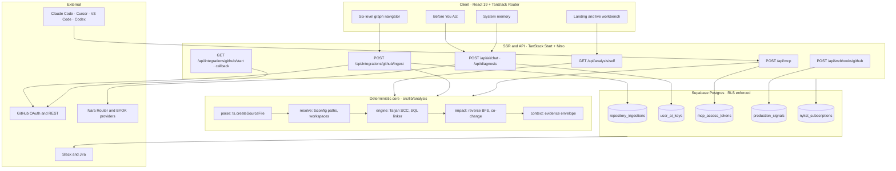
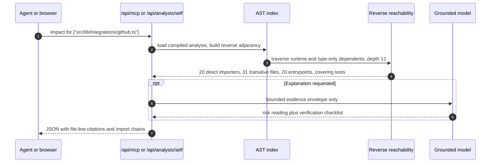

<a id="top"></a>

<p align="center">
  
</p>

<div align="center">


**Know the blast radius before you change the code.**

Nykst compiles a repository with the TypeScript AST, links SQL migrations and external services, runs Tarjan cycle analysis over the import graph, and answers one question with evidence: *if I touch this file, what breaks?*

Every number it reports is computed from real source, with file and line citations. Nothing is seeded, sampled, or guessed.

<br/>

[](https://nykst.unifies.codes)
[](https://nykst.unifies.codes/mcp)
[](#quick-start)
[](https://github.com/flawsom/nykst-software-intellegence)

<br/>

[](#roadmap)
[](LICENSE)
[](.github/workflows/ci.yml)
[](#tech-stack)
[](#api)
[](#quick-start)

<!-- Repository counters (stars, forks, issues, pull requests, downloads, last commit,
     contributors) use the GitHub badge endpoints and read as "repo not found" while this
     repository is private. Uncomment them once the repository is public.

[](https://github.com/flawsom/nykst-software-intellegence/stargazers)
[](https://github.com/flawsom/nykst-software-intellegence/forks)
[](https://github.com/flawsom/nykst-software-intellegence/releases)
[](https://github.com/flawsom/nykst-software-intellegence/issues)
[](https://github.com/flawsom/nykst-software-intellegence/pulls)
[](https://github.com/flawsom/nykst-software-intellegence/commits/main)
[](https://github.com/flawsom/nykst-software-intellegence/graphs/contributors)
-->

</div>

<div align="center">
  
</div>

<div align="center">

**Navigate** &nbsp;·&nbsp; [Why](#why) · [Features](#features) · [Screens](#screens) · [Demo](#demo) · [Architecture](#architecture) · [Stack](#tech-stack) · [Quick start](#quick-start) · [Structure](#structure) · [Env vars](#env) · [API](#api) · [Usage](#usage) · [Performance](#performance) · [Testing](#testing) · [Deploy](#deploy) · [Contributing](#contributing) · [Roadmap](#roadmap) · [FAQ](#faq) · [Support](#support)

</div>

<details>
<summary><b>Full table of contents</b></summary>

<br/>

1. [Why Nykst](#why)
2. [Features](#features)
3. [Screens](#screens)
4. [Demo](#demo)
5. [Architecture](#architecture)
6. [Tech stack](#tech-stack)
7. [Quick start](#quick-start)
8. [Project structure](#structure)
9. [Environment variables](#env)
10. [API reference](#api)
11. [Usage examples](#usage)
12. [Performance](#performance)
13. [Testing](#testing)
14. [Deployment](#deploy)
15. [Contributing](#contributing)
16. [Roadmap](#roadmap)
17. [FAQ](#faq)
18. [Acknowledgements](#acknowledgements)
19. [License](#license)
20. [Support](#support)

</details>

---

<a id="why"></a>

## 🧠 Why Nykst

Most "AI for code" tools chunk files into token windows, embed them into a vector store, and let a model guess which chunks are related. That works for prose. Software is not prose: it is a typed dependency graph that changes over time.

Nykst indexes the graph itself.

```text
Organization  ->  Domain        ->  Capability     ->  Service      ->  Module     ->  File
flawsom           src/lib           analysis           supabase          impact.ts     line-level
                  src/routes        integrations       github-oauth      graph.ts      importers
```

| Dimension | Typical chat-with-code tool | Nykst |
| :--- | :--- | :--- |
| Indexing primitive | 500-token text chunks | **TypeScript AST** via `ts.createSourceFile`, with `tsconfig` path aliases and workspace packages resolved |
| Blast radius | Model guesses from naming similarity | **Exact reverse reachability** over the import graph, with importing file and line for every dependent |
| Cycles | Usually invisible | **Iterative Tarjan SCC**, runtime cycles separated from `import type` |
| Database lineage | SQL files treated as plain text | **DDL linker**: `CREATE TABLE` / `FUNCTION` mapped to `.from()` / `.rpc()` call sites |
| Memory | Stateless per prompt | **Six layers** of repository memory: co-change, decisions, incidents, conventions, failures, continuity |
| Agent access | Editor fork or proprietary plugin | **Stateless Streamable HTTP MCP** at `/api/mcp`, 5 read-only tools, any MCP client |
| Data provenance | Demo workspaces and sample data | **Zero mock data**: the workbench compiles a real repository at request time and cites file and line for every claim |

> [!IMPORTANT]
> **Read-only by construction.** Nykst never writes to your repository. GitHub access is read-only, every answer is computed from source, and all five MCP tools are annotated `readOnlyHint: true`. There is no training on your code.

<div align="right"><a href="#top">Back to top</a></div>

---

<a id="features"></a>

## ✨ Features

<table>
<tr>
<td width="33%" valign="top">
<h3>Six-level graph navigation</h3>
<p><sub>Organization to domain to capability to service to module to file. Each selection re-centers the topology, syncs the breadcrumb and tree, and keeps browser history intact.</sub></p>
</td>
<td width="33%" valign="top">
<h3>Live self-indexed workbench</h3>
<p><sub>The landing page runs <code>analyzeRepository</code> over a real checkout at request time. Click any hub to read its importers, entrypoints, and SQL resources with line citations.</sub></p>
</td>
<td width="33%" valign="top">
<h3>Before You Act</h3>
<p><sub>Assemble a consequence envelope before editing: direct and transitive importers, affected entrypoints, covering tests, co-changing files, and grounded risk reasoning.</sub></p>
</td>
</tr>
<tr>
<td valign="top">
<h3>Six-layer system memory</h3>
<p><sub>Outcome-weighted decisions, failure patterns, incidents, team conventions, and continuity, all anchored to real artifacts and commits rather than a wiki nobody updates.</sub></p>
</td>
<td valign="top">
<h3>Streamable HTTP MCP</h3>
<p><sub>One <code>nyk_</code> token connects Claude Code, Cursor, VS Code, Codex, Windsurf, Gemini CLI, Cline, and Zed to <code>/api/mcp</code>.</sub></p>
</td>
<td valign="top">
<h3>Platform AI plus BYOK</h3>
<p><sub>Works immediately on <code>agnes-2.5-flash</code> through Nara Router. Add your own OpenAI, Anthropic, Gemini, DeepSeek, or OpenRouter key; it is sealed with AES-256-GCM.</sub></p>
</td>
</tr>
<tr>
<td valign="top">
<h3>SQL and service linker</h3>
<p><sub>Parses <code>supabase/migrations/*.sql</code> and Prisma models, then connects tables and RPCs to the client call sites that depend on them, with line citations.</sub></p>
</td>
<td valign="top">
<h3>Production signals</h3>
<p><sub>HMAC-SHA256 verified GitHub webhooks feed a root-cause engine that ties operational failures back to the exact code paths that could produce them.</sub></p>
</td>
<td valign="top">
<h3>Motion with restraint</h3>
<p><sub>Cursor spotlight, film grain, specular tilt cards, magnetic CTAs, scramble decoders, and telemetry marquees, all reduced-motion aware and GPU friendly.</sub></p>
</td>
</tr>
</table>

<div align="right"><a href="#top">Back to top</a></div>

---

<a id="screens"></a>

## 📸 Screens

Real captures from the running application. No mockups.

### Landing: live AST telemetry

<p align="center">
  
</p>

### Navigator: six-level graph and inspector

<p align="center">
  
</p>

<table>
<tr>
<td width="50%" valign="top">
<b>System memory</b><br/>
<sub>Dependency topology, change intelligence, risk profile, and grounded Q&amp;A over live artifacts.</sub><br/><br/>

</td>
<td width="50%" valign="top">
<b>Subscription and vault</b><br/>
<sub>Monthly and annual plans with QR settlement, plus the encrypted BYOK provider panel.</sub><br/><br/>

</td>
</tr>
</table>

<table>
<tr>
<td width="62%" valign="top">

</td>
<td width="38%" valign="top">

</td>
</tr>
<tr>
<td align="center"><sub><b>MCP setup</b> · revocable <code>nyk_</code> tokens, SHA-256 hashed, copy-paste configs for nine agents</sub></td>
<td align="center"><sub><b>Mobile</b> · the full dark-glass hierarchy on a narrow viewport</sub></td>
</tr>
</table>

<div align="right"><a href="#top">Back to top</a></div>

---

<a id="demo"></a>

## 🎥 Demo

<div align="center">

[](https://nykst.unifies.codes)
[](https://nykst.vercel.app)
[](#demo)

</div>

### Live surfaces

| Surface | What you can do | URL |
| :--- | :--- | :--- |
| **Landing and AST workbench** | Explore this repository compiled live, click a hub, read exact importer lines, inspect SQL resources | [`/`](https://nykst.unifies.codes/) |
| **System graph** | Walk from organization to file, open a dossier, run Before You Act | [`/graph`](https://nykst.unifies.codes/graph) |
| **System memory** | Browse change intelligence and risk, ask a grounded question | [`/intelligence`](https://nykst.unifies.codes/intelligence) |
| **MCP hub** | Mint a token and copy a ready config for your agent | [`/mcp`](https://nykst.unifies.codes/mcp) |
| **Health probe** | JSON readiness for Supabase and every required table | [`/api/health`](https://nykst.unifies.codes/api/health) |

<details>
<summary><b>Embedding a GIF, MP4, or YouTube walkthrough</b></summary>

<br/>

- **GIF**: record a short capture to `docs/assets/demo.gif`, then embed with ``.
- **MP4**: drag the file into a GitHub issue or PR comment; the generated `user-attachments` URL renders as a native HTML5 player.
- **YouTube**: link a 16:9 thumbnail to the video so the README stays lightweight.
- **Loom or Vercel preview**: link it from this section rather than embedding a heavy iframe.

</details>

<div align="right"><a href="#top">Back to top</a></div>

---

<a id="architecture"></a>

## 🏗 Architecture

Three planes, one contract: the analysis core produces deterministic evidence, the app renders it, and the MCP endpoint serves the same evidence to agents.



### The `get_impact` path



### Layers

| Layer | Responsibility | Where |
| :--- | :--- | :--- |
| Parse | Imports, exports, calls, env reads, SDK usage, URLs | `src/lib/analysis/parse.server.ts` |
| Resolve | `tsconfig` aliases, workspace packages, path normalization | `src/lib/analysis/resolve.ts` |
| Analyze | Tarjan SCC, SQL DDL and Prisma linking, service extraction | `src/lib/analysis/engine.server.ts` |
| Impact | Reverse BFS, import chains, co-change history, tests | `src/lib/analysis/impact.ts` |
| Shape | Six-level graph and dossiers | `src/lib/analysis/graph.ts` |
| Serve | Five read-only MCP tools | `src/lib/analysis/tools.ts`, `src/lib/mcp.server.ts` |
| Store | Snapshots, keys, tokens, signals, subscriptions | `supabase/migrations` |

### Security model

- **OAuth only.** GitHub authorization happens on GitHub's consent screen. The callback validates an HMAC-signed state cookie and a host-matched redirect.
- **Row-level security on every table.** Anonymous reads of private tables are revoked and covered by tests.
- **Two secrets at rest.** BYOK provider keys are encrypted with AES-256-GCM under `NYKST_BYOK_SECRET`; MCP tokens are stored as SHA-256 hashes and shown once.
- **No write scopes.** A repository is fetched as a tarball, parsed in memory, and reduced to structural metadata.

<div align="right"><a href="#top">Back to top</a></div>

---

<a id="tech-stack"></a>

## 🛠 Tech stack

<table>
<tr><td width="18%"><b>Frontend</b></td><td>


</td></tr>
<tr><td><b>Backend</b></td><td>


</td></tr>
<tr><td><b>Database</b></td><td>


</td></tr>
<tr><td><b>Cloud</b></td><td>


</td></tr>
<tr><td><b>DevOps</b></td><td>


</td></tr>
<tr><td><b>AI</b></td><td>


</td></tr>
<tr><td><b>APIs</b></td><td>


</td></tr>
<tr><td><b>Testing</b></td><td>


</td></tr>
<tr><td><b>Tools</b></td><td>


</td></tr>
</table>

<div align="right"><a href="#top">Back to top</a></div>

---

<a id="quick-start"></a>

## ⚡ Quick start

### Prerequisites

| Tool | Version | Why |
| :--- | :--- | :--- |
| [Bun](https://bun.sh) | `>= 1.2` | Install, scripts, and `bun:test` |
| Node.js | `>= 20` (22.12+ for the TanStack server) | Build and runtime |
| Supabase project | Free tier is enough | Postgres, RLS, Realtime |
| GitHub OAuth App | Standard | Read-only repository access |

### Install and run

```bash
git clone https://github.com/flawsom/nykst-software-intellegence.git
cd nykst-software-intellegence
bun install
bun run dev                  # http://localhost:8080, no credentials required for the live workbench
```

Without any Supabase credentials the landing page, the AST workbench, and `/graph` still run, because the analyzer compiles the local repository directly. Persistence, chat, MCP tokens, and billing need a database.

### Environment

Create `.env.local` in the repository root. Never commit it.

```bash
# Supabase
SUPABASE_URL=https://<ref>.supabase.co
SUPABASE_PUBLISHABLE_KEY=sb_publishable_...
SUPABASE_SERVICE_ROLE_KEY=eyJ...
VITE_SUPABASE_URL=https://<ref>.supabase.co
VITE_SUPABASE_PUBLISHABLE_KEY=sb_publishable_...

# GitHub OAuth
GITHUB_CLIENT_ID=Ov23li...
GITHUB_CLIENT_SECRET=...
GITHUB_WEBHOOK_SECRET=...

# Vault and platform AI
NYKST_BYOK_SECRET=<32+ random characters>
NYKST_AI_API_KEY=...
NYKST_AI_BASE_URL=https://router.bynara.id/v1
NYKST_AI_MODEL=agnes-2.5-flash
```

### Database

Apply `supabase/schema.sql` in the Supabase SQL editor (idempotent), or run the migrations in order:

```bash
for f in supabase/migrations/*.sql; do
  psql "$DATABASE_URL" -f "$f"
done
curl -s http://localhost:8080/api/health | jq
```

### Verify

```bash
bunx tsc -b --noEmit    # strict typecheck, zero errors
bun test ./tests        # 23 tests, 130 assertions
bun run build           # Nitro SSR production build
```

### Docker

Save this as `Dockerfile`:

```dockerfile
FROM oven/bun:1.2-alpine AS build
WORKDIR /app
COPY package.json bun.lock ./
RUN bun install --frozen-lockfile
COPY . .
RUN bun run build

FROM node:22-alpine AS runtime
WORKDIR /app
ENV NODE_ENV=production PORT=8080
COPY --from=build /app/.output ./.output
EXPOSE 8080
CMD ["node", ".output/server/index.mjs"]
```

```bash
docker build -t nykst:latest .
docker run -d --name nykst -p 8080:8080 --env-file .env.local nykst:latest
```

### Production

```bash
bun run build          # emits .output (Nitro SSR) and .vercel/output
```

Then deploy `.output` with the command for your platform, listed under [Deployment](#deploy).

<div align="right"><a href="#top">Back to top</a></div>

---

<a id="structure"></a>

## 📁 Project structure

```text
nykst-software-intellegence/
├── public/
│   ├── favicon.svg                  Hexagonal prism mark
│   ├── logo.svg                     Wordmark
│   └── esewa-qr.jpg                 Subscription QR
├── docs/assets/
│   ├── readme-banner.svg            Hero banner
│   ├── divider.svg                  Section divider
│   └── screens/                     Product captures
├── src/
│   ├── components/
│   │   ├── brand/                   Logo and wordmark components
│   │   ├── motion/                  Spotlight, tilt, scramble, counters
│   │   ├── graph/
│   │   │   ├── LiveGraphRagExplorer.tsx   AST workbench and MCP runner
│   │   │   ├── GraphCanvas.tsx            Six-level topology
│   │   │   ├── NodeDossier.tsx            File and service evidence
│   │   │   ├── BeforeYouAct.tsx           Consequence envelope
│   │   │   ├── MentorPanel.tsx            Grounded Q and A
│   │   │   └── ApiSettings.tsx            BYOK provider vault
│   │   ├── mcp/                     Token and agent setup UI
│   │   └── ui/                      Radix plus Tailwind primitives
│   ├── lib/
│   │   ├── analysis/
│   │   │   ├── engine.server.ts     AST compiler, SQL linker, Tarjan SCC
│   │   │   ├── parse.server.ts      Import and symbol extraction
│   │   │   ├── resolve.ts           Alias and workspace resolution
│   │   │   ├── impact.ts            Reverse BFS and co-change
│   │   │   ├── graph.ts             Six-level hierarchy
│   │   │   ├── context.ts           Evidence serializer
│   │   │   └── tools.ts             Five MCP tools
│   │   ├── integrations/github.ts   OAuth, tarball ingest, PR creation
│   │   ├── connectors/              Slack and Jira
│   │   ├── byok.server.ts           AES-256-GCM vault, Nara client
│   │   └── mcp.server.ts            JSON-RPC MCP implementation
│   └── routes/
│       ├── index.tsx                Landing and live workbench
│       ├── graph.tsx                Navigator
│       ├── intelligence.tsx         System memory
│       ├── mcp.tsx                  Agent setup
│       ├── subscribe.tsx            Billing
│       ├── admin.payments.tsx       Settlement queue
│       └── api.*.ts                 Typed server endpoints
├── supabase/
│   ├── schema.sql                   Consolidated idempotent schema
│   └── migrations/                  15 chronological migrations
├── scripts/analyze-local.ts         CLI for any local folder
├── tests/                           bun:test suites
└── docs/assets/                     README assets
```

<div align="right"><a href="#top">Back to top</a></div>

---

<a id="env"></a>

## 🔐 Environment variables

| Variable | Required | Scope | Format | Description |
| :--- | :---: | :--- | :--- | :--- |
| `SUPABASE_URL` | Yes | Server | `https://<ref>.supabase.co` | Project URL for server-side queries. |
| `SUPABASE_PUBLISHABLE_KEY` | Yes | Server | `sb_publishable_...` | RLS-scoped key for reads. |
| `SUPABASE_SERVICE_ROLE_KEY` | Yes | Server | `eyJ...` | Server-only writes: snapshots, keys, tokens, billing. |
| `VITE_SUPABASE_URL` | Yes | Client | `https://<ref>.supabase.co` | Browser client for Realtime. |
| `VITE_SUPABASE_PUBLISHABLE_KEY` | Yes | Client | `sb_publishable_...` | Browser key, guarded by RLS. |
| `GITHUB_CLIENT_ID` | Yes | Server | OAuth or App client id | GitHub authorization. |
| `GITHUB_CLIENT_SECRET` | Yes | Server | 40 hex chars | Token exchange and state signing. |
| `GITHUB_WEBHOOK_SECRET` | Yes | Server | Random string | Verifies `X-Hub-Signature-256` on `/api/webhooks/github`. |
| `GITHUB_REDIRECT_URI` | No | Server | Absolute URL | Optional override; otherwise the host is matched automatically. |
| `NYKST_BYOK_SECRET` | Yes | Server | 32+ characters | Derives the AES-256-GCM key for stored provider keys. |
| `NYKST_AI_API_KEY` | No | Server | `nara_...` or `sk-...` | Platform model so a first question works before BYOK. |
| `NYKST_AI_BASE_URL` | No | Server | `https://router.bynara.id/v1` | OpenAI-compatible router, HTTPS only. |
| `NYKST_AI_MODEL` | No | Server | `agnes-2.5-flash` | Platform model id. |
| `GEMINI_API_KEY` | No | Server | `AIza...` | Secondary platform fallback. |
| `SLACK_CLIENT_ID` / `_SECRET` | No | Server | Slack app credentials | Enables `/nykst` slash commands. |
| `JIRA_CLIENT_ID` / `_SECRET` | No | Server | Atlassian OAuth | Enables issue correlation. |
| `NYKST_ADMIN_GITHUB_ID` | No | Server | Numeric GitHub id | Grants `/admin/payments`. |

> [!WARNING]
> `SUPABASE_SERVICE_ROLE_KEY` and `NYKST_BYOK_SECRET` bypass or unlock protection layers. They belong in server environment variables only, never in `VITE_` variables and never in the repository.

<div align="right"><a href="#top">Back to top</a></div>

---

<a id="api"></a>

## 📖 API reference

**Base URL** `https://nykst.unifies.codes` (mirror `https://nykst.vercel.app`, local `http://localhost:8080`)

**Authentication**

- Browser and app routes: `HttpOnly; Secure; SameSite=Lax` cookie set by the OAuth callback.
- MCP: `Authorization: Bearer nyk_<token>`, stored as a SHA-256 hash.

| Method | Path | Auth | Purpose |
| :---: | :--- | :---: | :--- |
| `GET` | `/api/health` | Public | Supabase connectivity and required tables |
| `GET` | `/api/analysis/self` | Public | Compile the live workspace; `?path=`, `?tool=`, `?query=`, `?refresh=1` |
| `GET` | `/api/integrations/github/start` | Public | Signed state, then redirect to GitHub |
| `GET` | `/api/integrations/github/callback` | Public | Verify state, exchange code, set cookie |
| `POST` | `/api/integrations/github/ingest` | Session | Tarball fetch, AST and history analysis, snapshot write |
| `GET` | `/api/integrations/github/latest` | Session | Newest snapshot for the user |
| `GET` | `/api/integrations/github/{repositories,all-repositories,organizations,personal-repositories}` | Session | Repository discovery |
| `GET` | `/api/integrations/github/file-evidence` | Session | Evidence for one path |
| `POST` | `/api/integrations/github/coding` | Session | Grounded edit proposal with diff |
| `POST` | `/api/ai/chat` | Public or BYOK | Architecture Q and A (`mode: navigator \| code`) |
| `GET` `POST` `DELETE` | `/api/ai/key` | Session | Provider status, save, delete |
| `POST` | `/api/mcp` | Bearer `nyk_` | Streamable HTTP MCP, protocol `2025-06-18` |
| `GET` `POST` `DELETE` | `/api/mcp-tokens` | Session | Mint, list, revoke tokens |
| `POST` | `/api/diagnosis` | Session | Root-cause candidates for a production signal |
| `POST` | `/api/webhooks/github` | HMAC | Verified webhook intake |
| `GET` | `/api/integrations/{slack,jira,connectors}/*` | Session | Connector OAuth and command endpoints |
| `GET` `POST` | `/api/subscription` | Session | Plan state and settlement submission |

### Example: blast radius from a source checkout

```bash
curl -s "https://nykst.unifies.codes/api/analysis/self?path=src/lib/integrations/github.ts&tool=get_impact" \
  | jq '{
      repository,
      stats,
      target: .selectedTarget.path,
      level: .selectedTarget.briefing.impact.level,
      directImporters: (.selectedTarget.briefing.impact.direct_importers | length)
    }'
```

```json
{
  "repository": "flawsom/nykst-software-intellegence",
  "stats": {
    "treeFiles": 214,
    "sourceFiles": 160,
    "analyzedFiles": 160,
    "internalEdges": 317,
    "externalPackages": 52,
    "unresolvedImports": 0,
    "loc": 24571,
    "durationMs": 442
  },
  "target": "src/lib/integrations/github.ts",
  "level": "High",
  "directImporters": 20
}
```

### Example: grounded answer

```bash
curl -s -X POST "https://nykst.unifies.codes/api/ai/chat" \
  -H "Content-Type: application/json" \
  -d '{
    "prompt": "What breaks if I change src/lib/byok.server.ts?",
    "context": "Direct dependents: api.ai.chat.ts, api.ai.key.ts, api.diagnosis.ts",
    "mode": "navigator"
  }' | jq
```

### Example: MCP tool call

```bash
curl -s -X POST "https://nykst.unifies.codes/api/mcp" \
  -H "Authorization: Bearer nyk_your_token" \
  -H "Content-Type: application/json" \
  -d '{
    "jsonrpc": "2.0",
    "id": 1,
    "method": "tools/call",
    "params": {
      "name": "get_impact",
      "arguments": { "paths": ["src/lib/analysis/engine.server.ts"] }
    }
  }' | jq
```

MCP tools: `list_repositories`, `get_architecture`, `get_impact`, `find_usages`, `search_files`.

<div align="right"><a href="#top">Back to top</a></div>

---

<a id="usage"></a>

## 🎯 Usage examples

### Connect an agent

```bash
# Claude Code, available in every project
claude mcp add --transport http --scope user nykst \
  https://nykst.unifies.codes/api/mcp \
  --header "Authorization: Bearer $NYKST_TOKEN"
```

```json
// .cursor/mcp.json or .vscode/mcp.json
{
  "mcpServers": {
    "nykst": {
      "url": "https://nykst.unifies.codes/api/mcp",
      "headers": { "Authorization": "Bearer ${env:NYKST_TOKEN}" }
    }
  }
}
```

### Teach the agent when to use it

Add this to `CLAUDE.md`, `AGENTS.md`, or `.cursorrules`:

```markdown
## Before editing
1. Call get_impact with the files you plan to change and read every importer and entrypoint.
2. If the change touches a table, service, or env var, call find_usages and update every call site.
3. Run the covering tests returned by get_impact before you finish.
4. Cite file:line when you explain the change. If evidence is missing, say so.
```

### Run the analyzer locally

```bash
bun scripts/analyze-local.ts . --json /tmp/nykst-ast.json
jq '{stats, cycles: (.cycles | length)}' /tmp/nykst-ast.json
```

### Use it in CI

```yaml
- name: Blast radius report
  run: |
    bun scripts/analyze-local.ts . --json ast.json
    jq -e '.cycles | length == 0' ast.json
```

<div align="right"><a href="#top">Back to top</a></div>

---

<a id="performance"></a>

## 📊 Performance

Measured on this repository with Bun 1.4.2, from a source checkout, because the analyzer needs the `src/` tree to resolve imports. A bundled deployment that ships without source analyzes the files it carries instead, so its counts are smaller. Reproduce any row with the command beside it.

| Metric | Measured | Command |
| :--- | :--- | :--- |
| Cold AST compile, 160 files | **442 ms** | `curl -s localhost:8080/api/analysis/self \| jq .stats.durationMs` |
| Warm cached response | **4 to 6 ms** | `curl -o /dev/null -w '%{time_total}' localhost:8080/api/analysis/self` |
| Analyzed source | **160 files, 24,571 LOC** | `jq .stats` |
| Internal import edges | **317, zero unresolved** | `jq .stats.internalEdges, .stats.unresolvedImports` |
| Cycles | **0** | `jq '.cycles \| length'` |
| SQL and data resources | **12** | `jq '.resources \| length'` |
| External services | **9** | `jq '.services \| length'` |
| SSR landing response | **42 ms** | `curl -o /dev/null -w '%{time_total}' localhost:8080/` |
| Health probe, all tables | **~740 ms** | `curl -o /dev/null -w '%{time_total}' localhost:8080/api/health` |
| Client payload, all routes | **926 kB JS + 107 kB CSS** | `du -sh .output/public` |
| Test suite | **1.65 s, 23 tests** | `bun test ./tests` |

Lighthouse and bundle budgets are tracked, not asserted here. Run them against your own deployment, since results depend on region and network:

```bash
npx lighthouse https://nykst.unifies.codes --preset=desktop --view
npx lighthouse https://nykst.unifies.codes --preset=mobile --view
```

| Lighthouse category | Target | How to check |
| :--- | :--- | :--- |
| Performance | 90 or higher on desktop | `npx lighthouse <url> --preset=desktop` |
| Accessibility | 100, every image has `alt` and every control a name | same report, Accessibility tab |
| Best practices | 100, HTTPS and no console errors | same report |
| SEO | 100, unique title and description per route | same report |

Scores are not asserted in CI: they depend on the region, the network, and the Supabase latency of your deployment. Run the two commands above against your own URL before claiming a number.

<div align="right"><a href="#top">Back to top</a></div>

---

<a id="testing"></a>

## 🧪 Testing

```bash
bun test ./tests              # unit and integration suites
bun test --coverage ./tests   # coverage report
bunx tsc -b --noEmit          # strict typecheck, project references
bun run lint                  # ESLint
bun run format                # Prettier
```

| Suite | What it proves |
| :--- | :--- |
| `tests/schema.test.ts` | Every table and column in `supabase/schema.sql` exists in the generated types, RLS is enabled everywhere, private tables are not readable by `anon`, and live anonymous requests are rejected |
| `tests/repository-graph.test.ts` | Node ids are unique, file leaves carry exactly one real path, sibling labels never collide, and `childrenOf()` never invents children |
| `tests/connectors.test.ts` | Slack `v0` signature and replay rejection, ticket text to file resolution, `/nykst impact` formatting, Atlassian document round trip |

The suite runs offline for the graph and connector tests. The schema test skips live assertions when Supabase credentials are absent, so CI stays green without secrets.

<div align="right"><a href="#top">Back to top</a></div>

---

<a id="deploy"></a>

## 🚀 Deployment

OAuth callbacks are host-matched, so `nykst.unifies.codes`, `nykst.vercel.app`, preview subdomains, and `localhost:8080` all work without configuration.

<details open>
<summary><b>Vercel (primary, custom domain)</b></summary>

<br/>

```bash
bunx vercel link
bunx vercel env add SUPABASE_SERVICE_ROLE_KEY production
bunx vercel env add GITHUB_CLIENT_SECRET production
bunx vercel env add NYKST_BYOK_SECRET production
bunx vercel env add NYKST_AI_API_KEY production
bunx vercel --prod
```

The build runs `npm install` from `package-lock.json` and `vite build`. Keep TanStack packages current: Vercel blocks versions with known advisories.

</details>

<details>
<summary><b>Cloudflare Workers</b></summary>

<br/>

```bash
bun run build
npx wrangler secret put SUPABASE_SERVICE_ROLE_KEY
npx wrangler secret put GITHUB_CLIENT_SECRET
npx wrangler secret put NYKST_BYOK_SECRET
npx wrangler secret put NYKST_AI_API_KEY
npx wrangler deploy
```

</details>

<details>
<summary><b>Netlify</b></summary>

<br/>

- Build command: `bun run build`
- Publish directory: `.output/public`
- Functions directory: `.output/server`
- Add environment variables under Site configuration.

</details>

<details>
<summary><b>Railway</b></summary>

<br/>

1. Create a project from `flawsom/nykst-software-intellegence`.
2. Build `bun install && bun run build`, start `node .output/server/index.mjs`.
3. Add variables from [Environment variables](#env).

</details>

<details>
<summary><b>Docker</b></summary>

<br/>

Use the multi-stage file from [Quick start](#quick-start). The runtime image only needs `.output`.

</details>

<details>
<summary><b>AWS (App Runner or ECS Fargate)</b></summary>

<br/>

1. Build and push the image to ECR.
2. Run it on port `8080` with secrets from AWS Secrets Manager.
3. Point Route 53 at the service and register the callback URL on your GitHub OAuth App.

</details>

<details>
<summary><b>DigitalOcean App Platform</b></summary>

<br/>

1. Connect the repository.
2. Build `bun run build`, run `node .output/server/index.mjs`, HTTP port `8080`.
3. Mark secret variables as encrypted.

</details>

<div align="right"><a href="#top">Back to top</a></div>

---

<a id="contributing"></a>

## 🤝 Contributing

Contributions that sharpen the analysis engine, widen language support, or improve the navigator are welcome.

**Branches** `feat/<scope>`, `fix/<scope>`, `perf/<scope>`, `docs/<scope>`, `test/<scope>`

**Commits** Conventional Commits, for example `feat(analysis): resolve tsconfig project references`.

**Authorship** Commits must belong to the human who wrote them. Do not add bot identities, AI co-author trailers, or automated footers. This keeps the contributor graph an honest record of the people who built the project.

**Pull requests**

1. Branch from `main` and keep the change scoped.
2. Add tests in `tests/` for new analysis or connector behavior.
3. Run `bunx tsc -b --noEmit`, `bun test ./tests`, and `bun run lint` locally.
4. Describe the evidence: which files move, what depends on them, and which tests cover it. If you used Nykst itself, paste the `get_impact` summary.

<div align="right"><a href="#top">Back to top</a></div>

---

<a id="roadmap"></a>

## 🗺 Roadmap

- [x] Deterministic TypeScript AST compiler with alias and workspace resolution
- [x] Iterative Tarjan SCC cycle detection
- [x] SQL migration and Prisma linking to client call sites
- [x] Six-level software graph from organization to file
- [x] Live self-indexed workbench with zero mock data
- [x] Before You Act consequence envelope
- [x] Six-layer system memory
- [x] Streamable HTTP MCP with five read-only tools
- [x] Platform AI plus encrypted BYOK vault
- [x] Multi-origin GitHub OAuth
- [x] Slack and Jira connectors
- [x] eSewa subscription flow with admin verification
- [ ] Incremental graph patching on push webhooks, no full tarball re-download
- [ ] Tree-sitter adapters for Python, Go, and Rust
- [ ] Cross-repository federation over OpenAPI and gRPC contracts
- [ ] OpenTelemetry trace overlay on static edges
- [ ] Pull request bot that posts blast radius as a review comment
- [ ] Evidence-backed multimodal memory for diagrams, ADRs, and migrations

<div align="right"><a href="#top">Back to top</a></div>

---

<a id="faq"></a>

## ❓ FAQ

<details>
<summary><b>How is this different from Cursor, Cody, or Greptile?</b></summary>

<br/>

Those tools retrieve context, generate code, or review a diff. Nykst answers a narrower question with deterministic evidence: which files import this one, directly and transitively, which entrypoints reach it, which tests cover it, and what changed with it historically. The same evidence is exposed to humans and to agents.

</details>

<details>
<summary><b>Is any data mocked or seeded?</b></summary>

<br/>

No. The workbench runs the real analyzer at request time through `/api/analysis/self` over the files present on the server, and blocked database access reports the failure instead of inventing numbers. On a source checkout that is the full repository; on a bundled host it is the source tree that was deployed.

</details>

<details>
<summary><b>Which model runs by default?</b></summary>

<br/>

`agnes-2.5-flash` through Nara Router, with a Gemini fallback when configured. Reasoning is grounded on a bounded evidence envelope, never on a raw dump of your repository. Add your own provider key at any time; it is encrypted at rest and never returned to the browser.

</details>

<details>
<summary><b>Does it need write access to my repositories?</b></summary>

<br/>

No. Ingestion downloads a tarball with read-only scope and stores derived structure. Nothing is pushed to your code. The coding endpoint proposes a diff; opening a pull request is an explicit, separate action.

</details>

<details>
<summary><b>What happens when the code changes after ingestion?</b></summary>

<br/>

Snapshots are timestamped and the UI shows when the graph was built. A push webhook marks a snapshot stale, and the workbench can recompile on demand. Staleness is shown rather than hidden.

</details>

<details>
<summary><b>Which languages are supported today?</b></summary>

<br/>

TypeScript and JavaScript are first class, including `.tsx`, path aliases, and workspace packages. SQL migrations and Prisma models are linked as data resources. Other languages appear as files, not as resolved import edges, until the Tree-sitter adapters land.

</details>

<div align="right"><a href="#top">Back to top</a></div>

---

<a id="acknowledgements"></a>

## 🙌 Acknowledgements

- The **TypeScript team**, for the compiler API that makes a precise graph possible in a single pass.
- **TanStack**, for Start and Router.
- **Supabase**, for Postgres, row-level security, and Realtime.
- **Model Context Protocol**, for a standard way to hand architectural evidence to agents.
- **Radix UI**, **Tailwind CSS**, and **Lucide**, for the primitives behind the interface.
- Everyone who filed a reproducible issue with a stack trace and a commit hash.

<div align="right"><a href="#top">Back to top</a></div>

---

<a id="license"></a>

## 📜 License

Released under the [MIT License](LICENSE). Copyright (c) 2026 Nykst.

<div align="right"><a href="#top">Back to top</a></div>

---

<a id="support"></a>

## ❤️ Support

If Nykst saved you from a bad merge, a star helps other engineers find it.

<div align="center">

[](https://github.com/flawsom/nykst-software-intellegence/stargazers)
[](https://github.com/sponsors/flawsom)
[](https://www.buymeacoffee.com/nykstsoftint)
[](mailto:nykstsoftint@gmail.com)

</div>

<p align="center">
  <sub>Built by <a href="https://github.com/flawsom">@flawsom</a> · <a href="https://nykst.unifies.codes">nykst.unifies.codes</a> · <a href="#top">Back to top</a></sub>
</p>
