<a id="top"></a>

<p align="center">
  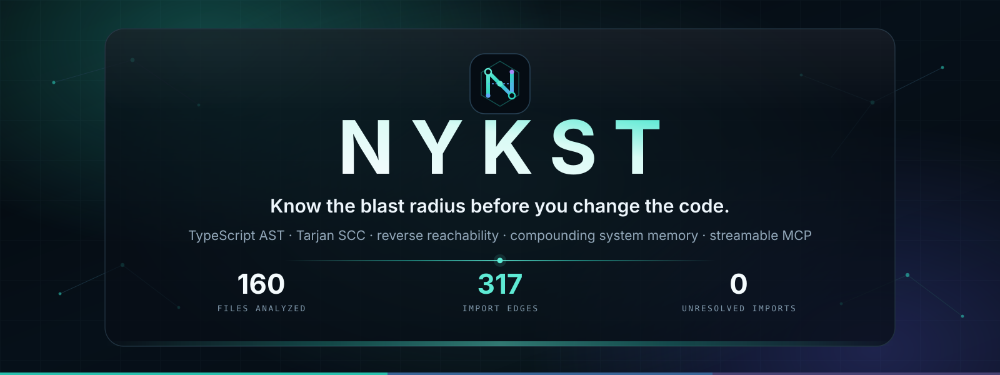
</p>

<div align="center">

<h1>Nykst</h1>

**Know the blast radius before you change the code.**

Nykst compiles a repository with the TypeScript compiler and static adapters for Python, Go, and Rust, links SQL migrations and external services, federates OpenAPI and gRPC contracts, overlays OpenTelemetry traces onto the static graph, and answers one question with evidence: _if I touch this file, what breaks?_

Push webhooks and local file watchers patch the graph from the changed files alone, with no second tarball download. Exported signatures carry parameter arity and type properties, SQL columns are checked against the calls that read them, and `simulate_change` previews a write before it happens. Every number it reports is computed from real source, with file and line citations. Nothing is seeded, sampled, or guessed.

<br/>

[](https://nykst.unifies.codes)
[](https://nykst.unifies.codes/mcp)
[](#quick-start)
[](https://github.com/flawsom/nykst)

<br/>

[](#roadmap)
[](LICENSE)
[](.github/workflows/ci.yml)
[](.github/workflows/e2e.yml)
[](#tech-stack)
[](#api)
[](#quick-start)

<br/>

[](https://github.com/flawsom/nykst/stargazers)
[](https://github.com/flawsom/nykst/forks)
[](https://github.com/flawsom/nykst/releases)
[](https://github.com/flawsom/nykst/issues)
[](https://github.com/flawsom/nykst/pulls)
[](https://github.com/flawsom/nykst/commits/main)
[](https://github.com/flawsom/nykst/graphs/contributors)

</div>

<div align="center">
  
</div>

<div align="center">

**Navigate** &nbsp;·&nbsp; [Why](#why) · [Features](#features) · [Screens](#screens) · [Demo](#demo) · [Architecture](#architecture) · [Stack](#tech-stack) · [Quick start](#quick-start) · [Structure](#structure) · [Env vars](#env) · [API](#api) · [Usage](#usage) · [Performance](#performance) · [Testing](#testing) · [Deploy](#deploy) · [Contributing](#contributing) · [Roadmap](#roadmap) · [FAQ](#faq) · [Support](#support)

</div>

<details>
<summary><b>Full table of contents</b></summary>

<br/>

1. [Why Nykst](#why)
2. [Features](#features)
3. [Screens](#screens)
4. [Demo](#demo)
5. [Architecture](#architecture)
6. [Tech stack](#tech-stack)
7. [Quick start](#quick-start)
8. [Project structure](#structure)
9. [Environment variables](#env)
10. [API reference](#api)
11. [Usage examples](#usage)
12. [Performance](#performance)
13. [Testing](#testing)
14. [Deployment](#deploy)
15. [Contributing](#contributing)
16. [Roadmap](#roadmap)
17. [FAQ](#faq)
18. [Acknowledgements](#acknowledgements)
19. [License](#license)
20. [Support](#support)

</details>

---

<a id="why"></a>

## 🧠 Why Nykst

AI writes code fast. Hidden dependencies in real codebases are what break production: a caller three hops away, an exported signature that changed arity, a SQL column a migration dropped, or a runtime import cycle nobody saw.

Nykst checks architecture and history first, then verifies every proposed change in memory against the compiled AST, SQL columns and API routes, and jumps straight to the exact `file:line` before anything ships.

```text
Organization  ->  Domain        ->  Capability     ->  Service      ->  Module     ->  File
flawsom           src/lib           analysis           supabase          impact.ts     line-level
                  src/routes        integrations       github-oauth      graph.ts      importers
```

### Architectural Verification Matrix: Blind Code Generation vs. Nykst Closed-Loop Engine

| Dimension                  | Unverified editing                                    | Nykst deterministic loop                                                                                                                                                         |
| :------------------------- | :---------------------------------------------------- | :------------------------------------------------------------------------------------------------------------------------------------------------------------------------------- |
| Grounding                  | Model starts from a prompt and guesses relevant files | **Stage 1**: bounded AST envelope with signature arity, direct importers, SQL lineage and six memory layers, assembled before the edit                                           |
| Blast radius               | Model guesses from naming similarity                  | **Exact reverse reachability** over the import graph, with importing file and line for every dependent                                                                           |
| Cycles                     | Usually invisible                                     | **Iterative Tarjan SCC**, runtime cycles separated from `import type`                                                                                                            |
| Database lineage           | SQL files treated as plain text                       | **DDL linker**: `CREATE TABLE` / `FUNCTION` mapped to `.from()` / `.rpc()` call sites                                                                                            |
| Memory                     | Stateless per prompt                                  | **Six layers** of repository memory: co-change, decisions, incidents, conventions, failures, continuity                                                                          |
| Change verification        | Edit on disk, then wait for the build to fail         | **Stage 3**: `simulate_change` overlays the proposal on an in-memory graph clone and reports new cycles, unresolved imports and column drift                                     |
| Remediation                | Retry loop until the compiler is quiet                | **Stage 4**: `generate_fix_patch` applies four deterministic strategies and returns a diff only when the verified breaking score falls without adding a cycle (`verified: true`) |
| Agent access               | Editor fork or proprietary plugin                     | **Stateless Streamable HTTP MCP** at `/api/mcp`, 11 read-only tools, any MCP client                                                                                              |
| Change propagation         | Full re-index on every push                           | **Incremental graph patching** from changed files only, measured under 15 ms for 500 files                                                                                       |
| Cross-repository contracts | Invisible or manually maintained                      | **OpenAPI and gRPC federation** matched to literal consumer routes, with unmatched calls reported                                                                                |
| Runtime evidence           | Static graph only                                     | **OTLP trace overlay** that marks which static edges were observed and which were not                                                                                            |
| Data provenance            | Demo workspaces and sample data                       | **Zero mock data**: the workbench compiles a real repository at request time and cites file and line for every claim                                                             |

### Ecosystem benchmark: what each tool covers, and what Nykst adds

This table reflects each project's publicly documented scope. It is a capability map, not a quality score: every tool below is useful for the job it was built for.

| Tool              | Local-first |       MCP tools        |    In-memory pre-flight    |   SQL and contract lineage    |  Verified AST auto-heal  | License     |
| :---------------- | :---------: | :--------------------: | :------------------------: | :---------------------------: | :----------------------: | :---------- |
| Harmony MCP       |     No      |    Memory retrieval    |             No             |              No               |            No            | Proprietary |
| CodeGraph         |     Yes     |      Graph query       |             No             |              No               |            No            | MIT         |
| GitNexus          |     Yes     |      Graph query       |             No             |              No               |            No            | PolyForm NC |
| Repomix           |     Yes     |           No           |             No             |              No               |            No            | MIT         |
| Serena            |     Yes     |  Yes, symbol and LSP   |             No             |              No               |            No            | MIT         |
| Greptile          |     No      |           No           |             No             |              No               |            No            | Proprietary |
| Sourcegraph Cody  |   Partial   |           No           |             No             |              No               |            No            | Proprietary |
| Augment CE        |     No      |           No           |             No             |              No               |            No            | Proprietary |
| grepai            |     Yes     |           No           |             No             |              No               |            No            | MIT         |
| code-review-graph |     Yes     |        Partial         |             No             |              No               |            No            | MIT         |
| **Nykst**         |   **Yes**   | **11 read-only tools** | **Yes, `simulate_change`** | **Yes, DDL replay and drift** | **Yes, four strategies** | **MIT**     |

### The 4-Stage Closed-Loop Safe-Coding Engine

| Stage                  | What it proves                                                                                                                                                                                                                                                                                 | Where it lives                                           |
| :--------------------- | :--------------------------------------------------------------------------------------------------------------------------------------------------------------------------------------------------------------------------------------------------------------------------------------------- | :------------------------------------------------------- |
| 1. Check Architecture  | Exported signatures with merged overload envelopes (`minArity..maxArity`), direct importers (`file:line`), transitive call chains, SQL tables and column contracts, six memory layers, and a one-click bounded agent context pack with measured token reduction against a blind full-repo scan | `SafeCodeLoopEngine.tsx` · `src/lib/analysis/context.ts` |
| 2. Write or Generate   | A real edit of the real file, a grounded provider generation seeded with the Stage 1 envelope, or a deterministic failure scenario: removed export, unresolved import, dropped column, runtime cycle, clean enhancement                                                                        | `SafeCodeLoopEngine.tsx` · `POST /api/loop`              |
| 3. Verify in Memory    | Overlay checks for new cycles, unresolved imports, SQL drift, removed exports and observed caller arity, now resolved through lexical scopes, function overload envelopes, namespace calls (`ns.fn()`) and transitive barrel re-exports (`export *`, `export { a as b }`); nothing is written  | `src/lib/analysis/simulate.ts` · `reexports.ts`          |
| 4. Verdict & Auto-Heal | Trinity cards state WHAT broke, WHY it broke and the ARCHITECTURAL reason, with a clickable multi-hop causal chain. The four-strategy AST healer repairs imports, arity and removed exports, runtime cycles and SQL column drift, then re-verifies the result in memory                        | `src/lib/analysis/fix.ts` · `CodeProblemInspector.tsx`   |

Call-site checks follow lexical scope bindings, merge overload signatures into one arity envelope, record namespace calls such as `ns.fn(...)`, and resolve transitive `export *` and `export { a as b }` chains back to the declaring file. `generate_fix_patch` runs four deterministic remediation strategies on an in-memory clone: `unresolved_import_rewrite`, `arity_and_export_compatibility_shim`, `runtime_cycle_to_import_type` and `sql_column_drift_rename`. A patch is returned only when the verified breaking score falls without adding a cycle. The overlay is still a static check rather than a full TypeScript assignability proof or a test run, so run the relevant typecheck and tests before deploying.

> [!IMPORTANT]
> **Read-only by construction.** Nykst never writes to your repository. GitHub access is read-only, every answer is computed from source, and all eleven MCP tools are annotated `readOnlyHint: true`. `simulate_change` and `generate_fix_patch` work on an in-memory clone and return evidence, never a commit. There is no training on your code.

<div align="right"><a href="#top">Back to top</a></div>

---

<a id="features"></a>

## ✨ Features

<table>
<tr>
<td width="33%" valign="top">
<h3>Six-level graph navigation</h3>
<p><sub>Organization to domain to capability to service to module to file. Each selection re-centers the topology, syncs the breadcrumb and tree, and keeps browser history intact.</sub></p>
</td>
<td width="33%" valign="top">
<h3>Live self-indexed workbench</h3>
<p><sub>The landing page runs <code>analyzeRepository</code> over a real checkout at request time. Click any hub to read its importers, entrypoints, and SQL resources with line citations.</sub></p>
</td>
<td width="33%" valign="top">
<h3>Before You Act</h3>
<p><sub>Assemble a consequence envelope before editing: direct and transitive importers, affected entrypoints, covering tests, co-changing files, and grounded risk reasoning.</sub></p>
</td>
</tr>
<tr>
<td valign="top">
<h3>Six-layer system memory</h3>
<p><sub>Outcome-weighted decisions, failure patterns, incidents, team conventions, and continuity, all anchored to real artifacts and commits rather than a wiki nobody updates.</sub></p>
</td>
<td valign="top">
<h3>Streamable HTTP MCP</h3>
<p><sub>One <code>nyk_</code> token connects Claude Code, Cursor, VS Code, Codex, Windsurf, Gemini CLI, Cline, and Zed to <code>/api/mcp</code>.</sub></p>
</td>
<td valign="top">
<h3>Platform AI plus BYOK</h3>
<p><sub>Connect an available platform model or add your own Cloudflare Workers AI, Gemini, OpenAI, Anthropic, DeepSeek, or OpenAI-compatible key. Personal keys are sealed with AES-256-GCM.</sub></p>
</td>
</tr>
<tr>
<td valign="top">
<h3>SQL and service linker</h3>
<p><sub>Parses <code>supabase/migrations/*.sql</code> and Prisma models, then connects tables and RPCs to the client call sites that depend on them, with line citations.</sub></p>
</td>
<td valign="top">
<h3>Production signals</h3>
<p><sub>HMAC-SHA256 verified GitHub webhooks feed a root-cause engine that ties operational failures back to the exact code paths that could produce them.</sub></p>
</td>
<td valign="top">
<h3>Motion with restraint</h3>
<p><sub>Cursor spotlight, film grain, specular tilt cards, magnetic CTAs, scramble decoders, and telemetry marquees, all reduced-motion aware and GPU friendly.</sub></p>
</td>
</tr>
</table>

<table>
<tr>
<td width="33%" valign="top">
<h3>Incremental push patching</h3>
<p><sub>A verified push webhook re-parses only the added and modified files, prunes deleted paths, and recomputes SQL bindings and Tarjan SCCs. No full tarball download.</sub></p>
</td>
<td width="33%" valign="top">
<h3>Polyglot compiler</h3>
<p><sub>Python imports, Go package blocks, and Rust <code>use</code> and <code>mod</code> declarations resolve into the same adjacency list as TypeScript, so impact crosses language boundaries.</sub></p>
</td>
<td width="33%" valign="top">
<h3>Contract federation</h3>
<p><sub>OpenAPI operations and gRPC methods are matched segment by segment against literal consumer routes across every analyzed repository.</sub></p>
</td>
</tr>
<tr>
<td valign="top">
<h3>Trace overlay</h3>
<p><sub>Upload OTLP JSON and see p50 and p95 latency, errors, and observed caller-callee edges attached to real files, without guessing unmatched spans.</sub></p>
</td>
<td valign="top">
<h3>PR blast-radius bot</h3>
<p><sub>Every opened, reopened, or synchronized pull request gets one deterministic review comment with risk tier, file citations, and a coverage gate. The bot updates its own comment.</sub></p>
</td>
<td valign="top">
<h3>Evidence-backed memory</h3>
<p><sub>ADRs, Mermaid diagrams, migrations, and image references become checksummed records with line citations, searchable through MCP.</sub></p>
</td>
</tr>
</table>

<table>
<tr>
<td width="33%" valign="top">
<h3>Exported signatures</h3>
<p><sub>Every exported function, class, interface, type, enum, and const carries parameter arity, required arity, return type, and type properties. The dossier and <code>search_files</code> show the exact public shape, not just a bare symbol name.</sub></p>
</td>
<td width="33%" valign="top">
<h3>SQL column contracts</h3>
<p><sub><code>CREATE TABLE</code> and <code>ALTER TABLE</code> columns replay in migration order. Literal <code>.select()</code>, <code>.insert()</code>, <code>.update()</code>, and filter calls name a column; unknown or dropped columns become findings in the dossier and Before You Act.</sub></p>
</td>
<td width="33%" valign="top">
<h3>Pre-flight simulation</h3>
<p><sub><code>simulate_change</code> overlays writes and deletions on a cloned graph. New cycles, newly unresolved imports, column drift, and the changed blast radius are returned before any file is touched.</sub></p>
</td>
</tr>
<tr>
<td valign="top">
<h3>Verified remediation</h3>
<p><sub><code>generate_fix_patch</code> rewrites imports, shims arity and restored exports, converts runtime cycles to type-only edges, and renames drifted SQL columns, then returns the diff only after the in-memory overlay confirms the breakage score fell.</sub></p>
</td>
<td valign="top">
<h3>Local graph watcher</h3>
<p><sub><code>bun run watch</code> holds the graph in memory and patches only changed source, SQL, contract, and docs files. No webhook, tarball, or full recompile is required.</sub></p>
</td>
<td valign="top">
<h3>One-command onboarding</h3>
<p><sub><code>npx nykst init</code> writes MCP configs for Claude Code, Cursor, VS Code, Windsurf, and Codex, plus a canonical <code>.nykst/mcp.json</code> and a local usage card.</sub></p>
</td>
</tr>
</table>

### Live workspace UI

The web application and the analysis engine share one graph, and the UI now behaves the same way on `/` and `/graph`:

- **Radial orbit layout with an accessible list view.** The focused node sits at the centre of the viewport and its children are placed by polar trigonometry (`angle = 2π·i/n − π/2`, `x = cx + r·cos(a)`, `y = cy + r·sin(a)`). Up to eight children use one orbit; more than eight use two staggered concentric orbits. A hub wider than 24 children keeps two readable orbits and offers a sector selector to reach every child in the canvas. A List toggle replaces the canvas with every child as a native, keyboard-focusable button, with full labels, a text filter over names and paths, the same drill and details actions, and no 24-child cap. There is no column or grid fallback, so a connected GitHub repository never collapses into a vertical lineup.
- **Curved dependency edges.** Every edge is a quadratic Bezier (`M ... Q ...`) from the centre hub to the child. Importer edges are teal (`#2DD4BF`), runtime cycle edges are red (`#F87171`), and the focused edge is amber. The legend sits under the canvas.
- **Repository switcher.** `<RepoSwitcherBar />` is mounted on `/`, `/graph` and `/intelligence`. Its first tab lists every ingested workspace (with branch, short commit, file and edge counts) plus `flawsom/nykst (Live Workspace)`; the second tab searches all accessible GitHub repositories, picks a branch, and calls the ingest endpoint with inline progress. Switching updates `?repo=` so the graph, dossier, envelope, memory page and reloads all follow the same repository.
- **Click-to-code.** Every `file:line` row in the dossier (importers, transitive dependents, entrypoints, SQL resources, column drift, exported signatures), in Before You Act, and in the landing workbench is a button. It opens `<CodeProblemInspector />`, which fetches the real source, scrolls to the line, highlights it, explains why the line matters, and offers three actions: inspect the node in the graph, open the exact line on GitHub (`#L<line>`), or open it in VS Code / Cursor (`vscode://file/...:<line>`).

<div align="right"><a href="#top">Back to top</a></div>

---

<a id="screens"></a>

## 📸 Screens

Real captures from the running application. No mockups.

### Landing: live AST telemetry

<p align="center">
  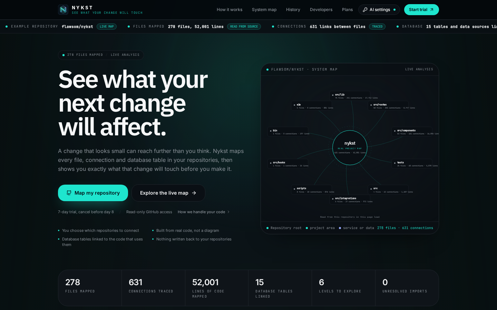
</p>

### Navigator: six-level graph and inspector

<p align="center">
  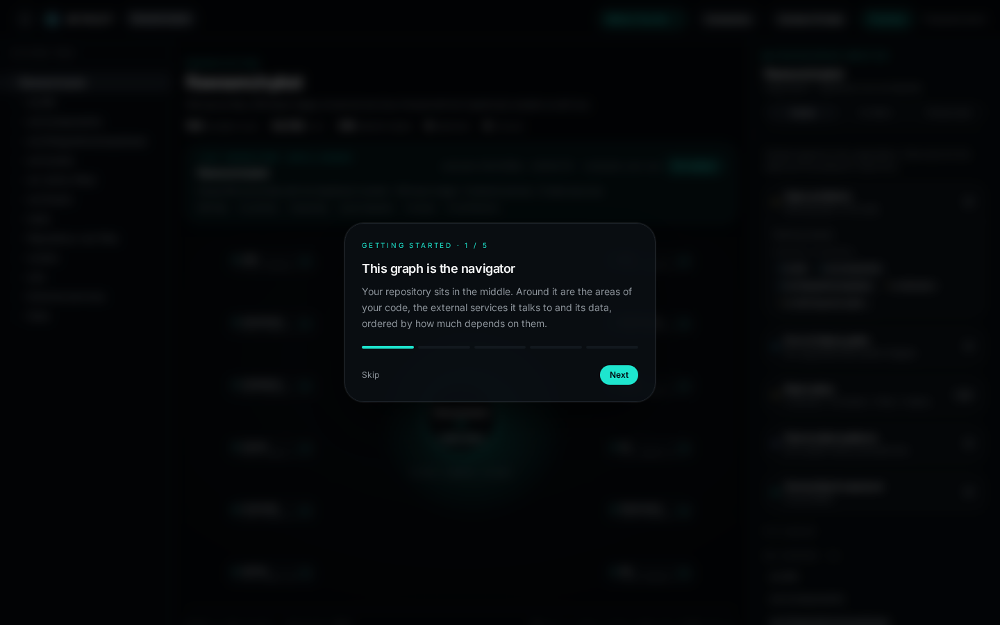
</p>

<table>
<tr>
<td width="50%" valign="top">
<b>System memory</b><br/>
<sub>Dependency topology, change intelligence, risk profile, and grounded Q&amp;A over live artifacts.</sub><br/><br/>
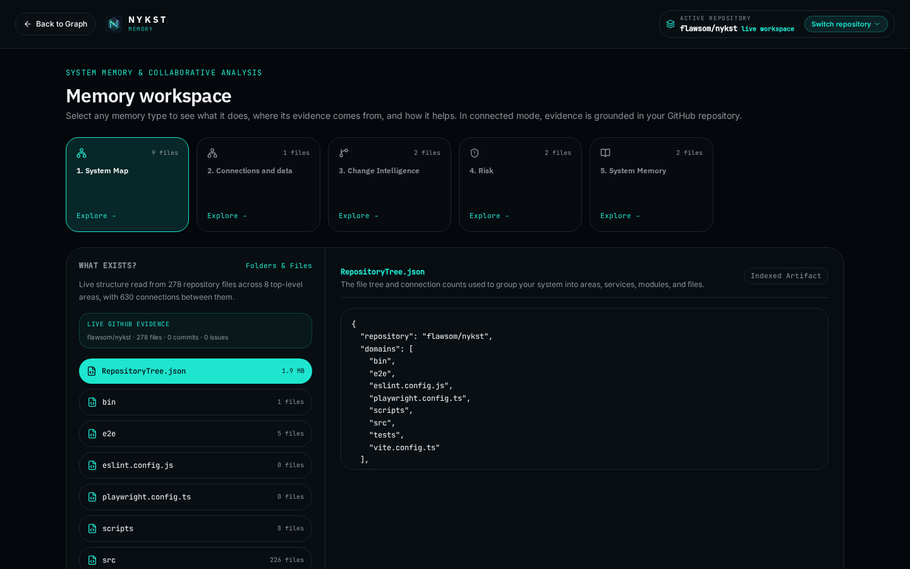
</td>
<td width="50%" valign="top">
<b>Subscription and vault</b><br/>
<sub>Monthly and annual plans with QR settlement, plus the encrypted BYOK provider panel.</sub><br/><br/>
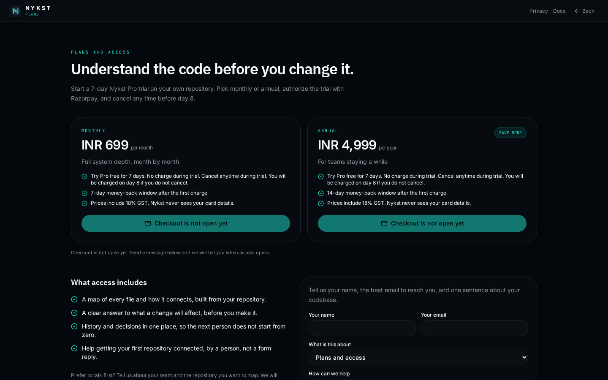
</td>
</tr>
</table>

<table>
<tr>
<td width="62%" valign="top">
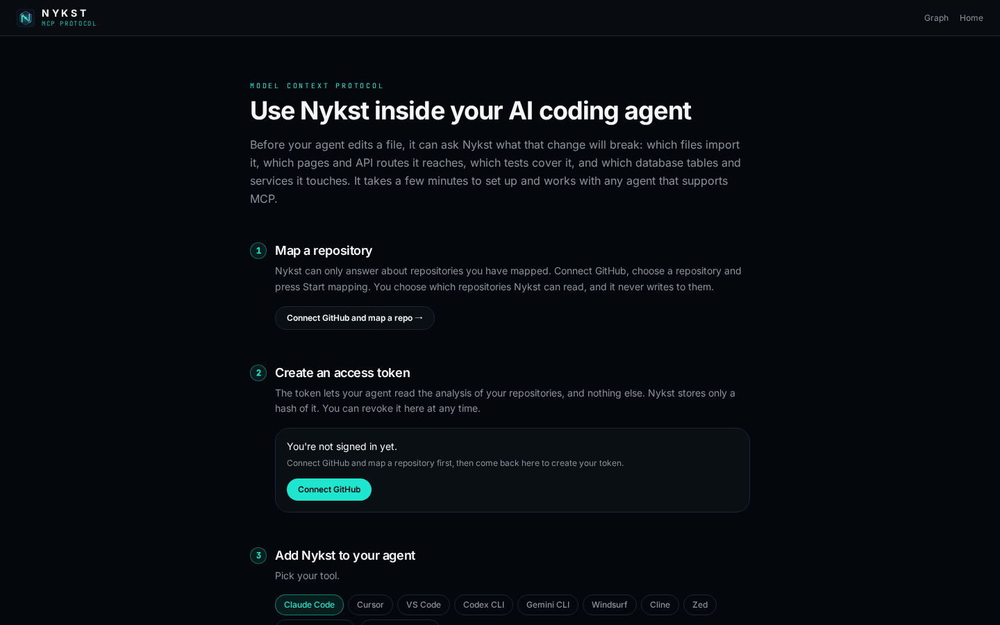
</td>
<td width="38%" valign="top">
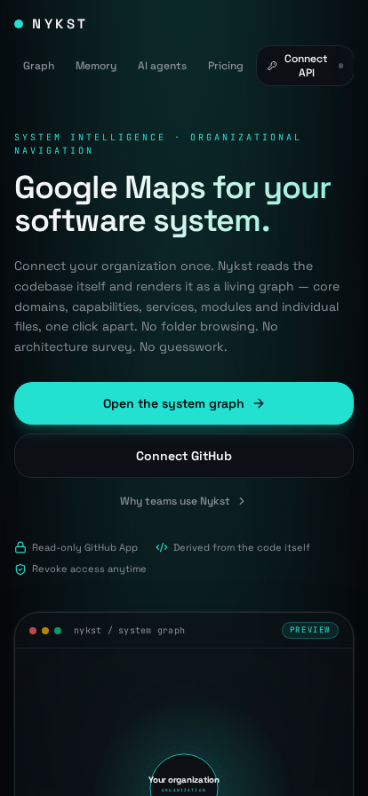
</td>
</tr>
<tr>
<td align="center"><sub><b>MCP setup</b> · revocable <code>nyk_</code> tokens, SHA-256 hashed, copy-paste configs for nine agents</sub></td>
<td align="center"><sub><b>Mobile landing</b> · the full dark-glass hierarchy on a narrow viewport</sub></td>
</tr>
</table>

<table>
<tr>
<td width="50%" valign="top" align="center">
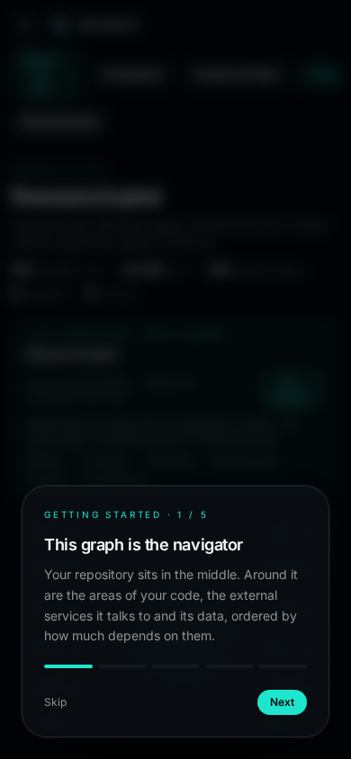<br/>
<sub><b>Mobile graph</b> · topology, breadcrumb and inspector stack cleanly</sub>
</td>
<td width="50%" valign="top" align="center">
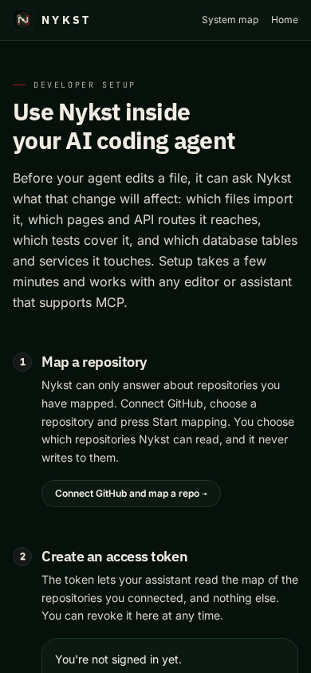<br/>
<sub><b>Mobile MCP</b> · token mint and agent guide without a horizontal scroll</sub>
</td>
</tr>
</table>

<div align="right"><a href="#top">Back to top</a></div>

---

<a id="demo"></a>

## 🎥 Demo

<div align="center">

[](https://nykst.unifies.codes)
[](https://nykst.vercel.app)
[](#demo)

</div>

### Live surfaces

| Surface                       | What you can do                                                                                      | URL                                                         |
| :---------------------------- | :--------------------------------------------------------------------------------------------------- | :---------------------------------------------------------- |
| **Landing and AST workbench** | Explore this repository compiled live, click a hub, read exact importer lines, inspect SQL resources | [`/`](https://nykst.unifies.codes/)                         |
| **System graph**              | Walk from organization to file, open a dossier, run Before You Act                                   | [`/graph`](https://nykst.unifies.codes/graph)               |
| **System memory**             | Browse change intelligence and risk, ask a grounded question                                         | [`/intelligence`](https://nykst.unifies.codes/intelligence) |
| **MCP hub**                   | Mint a token and copy a ready config for your agent                                                  | [`/mcp`](https://nykst.unifies.codes/mcp)                   |
| **Health probe**              | JSON readiness for Supabase and every required table                                                 | [`/api/health`](https://nykst.unifies.codes/api/health)     |

<details>
<summary><b>Embedding a GIF, MP4, or YouTube walkthrough</b></summary>

<br/>

- **GIF**: record a short capture to `docs/assets/demo.gif`, then embed with ``.
- **MP4**: drag the file into a GitHub issue or PR comment; the generated `user-attachments` URL renders as a native HTML5 player.
- **YouTube**: link a 16:9 thumbnail to the video so the README stays lightweight.
- **Loom or Vercel preview**: link it from this section rather than embedding a heavy iframe.

</details>

<div align="right"><a href="#top">Back to top</a></div>

---

<a id="architecture"></a>

## 🏗 Architecture

Three planes, one contract: the analysis core produces deterministic evidence, the app renders it, and the MCP endpoint serves the same evidence to agents.

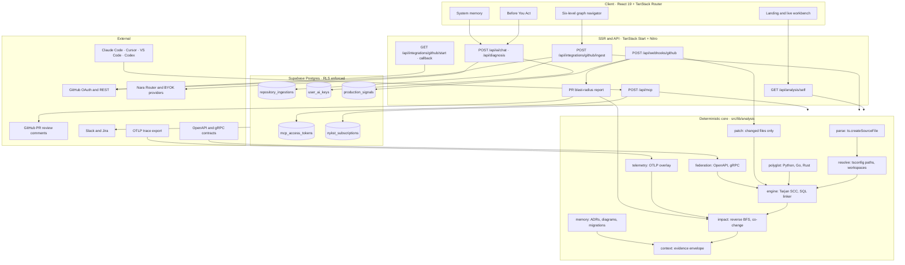

### The `get_impact` path

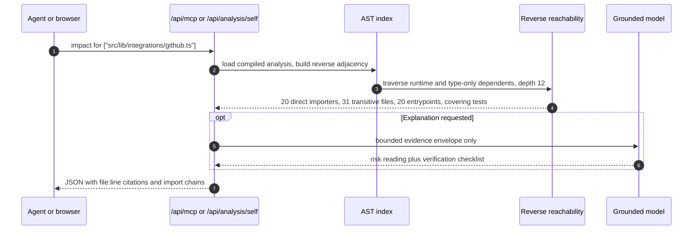

### Layers

| Layer     | Responsibility                                                                                                        | Where                                                |
| :-------- | :-------------------------------------------------------------------------------------------------------------------- | :--------------------------------------------------- |
| Parse     | Imports, exports, overload envelopes, scoped calls, namespace members, type properties, SQL literals, env reads, URLs | `src/lib/analysis/parse.server.ts`                   |
| Polyglot  | Python, Go, and Rust imports, symbols, endpoints, env reads                                                           | `src/lib/analysis/polyglot.ts`                       |
| Resolve   | `tsconfig` aliases, workspace packages, path normalization                                                            | `src/lib/analysis/resolve.ts`                        |
| Analyze   | Tarjan SCC, SQL DDL and Prisma linking, service extraction                                                            | `src/lib/analysis/engine.server.ts`                  |
| Contracts | Replay DDL columns, compare literal column references, report drift                                                   | `src/lib/analysis/sql.ts`                            |
| Patch     | Re-parse changed files, prune deletions, recompute SCCs and columns                                                   | `src/lib/analysis/patch.server.ts`                   |
| Simulate  | Overlay writes and deletions on a cloned graph                                                                        | `src/lib/analysis/simulate.ts`                       |
| Remediate | Four-strategy AST repair, verified on an in-memory clone                                                              | `src/lib/analysis/fix.ts`                            |
| Re-export | Transitive barrel resolution to the declaring symbol                                                                  | `src/lib/analysis/reexports.ts`                      |
| Watch     | Patch from local filesystem events                                                                                    | `scripts/watch.ts`                                   |
| Onboard   | Write agent MCP configs                                                                                               | `bin/nykst.mjs`                                      |
| Federate  | OpenAPI operations and gRPC methods to consumer call sites                                                            | `src/lib/analysis/federation.ts`                     |
| Observe   | OTLP spans onto static files and edges                                                                                | `src/lib/analysis/telemetry.ts`                      |
| Review    | Diff blast radius, risk tier, coverage gate, Markdown                                                                 | `src/lib/analysis/diff.ts`, `pr-review.server.ts`    |
| Remember  | Cited ADRs, diagrams, migrations, and image references                                                                | `src/lib/memory/evidence.ts`                         |
| Impact    | Reverse BFS, import chains, co-change history, tests                                                                  | `src/lib/analysis/impact.ts`                         |
| Shape     | Six-level graph and dossiers                                                                                          | `src/lib/analysis/graph.ts`                          |
| Serve     | Eleven read-only MCP tools                                                                                            | `src/lib/analysis/tools.ts`, `src/lib/mcp.server.ts` |
| Store     | Snapshots, keys, tokens, signals, subscriptions                                                                       | `supabase/migrations`                                |

### Security model

- **OAuth only.** GitHub authorization happens on GitHub's consent screen. The callback validates an HMAC-signed state cookie and a host-matched redirect.
- **Row-level security on every table.** Anonymous reads of private tables are revoked and covered by tests.
- **Two secrets at rest.** BYOK provider keys are encrypted with AES-256-GCM under `NYKST_BYOK_SECRET`; MCP tokens are stored as SHA-256 hashes and shown once.
- **No write scopes.** A repository is fetched as a tarball, parsed in memory, and reduced to structural metadata.

<div align="right"><a href="#top">Back to top</a></div>

---

<a id="tech-stack"></a>

## 🛠 Tech stack

<table>
<tr><td width="18%"><b>Frontend</b></td><td>


</td></tr>
<tr><td><b>Backend</b></td><td>


</td></tr>
<tr><td><b>Analysis</b></td><td>


</td></tr>
<tr><td><b>Database</b></td><td>


</td></tr>
<tr><td><b>Cloud</b></td><td>


</td></tr>
<tr><td><b>DevOps</b></td><td>


</td></tr>
<tr><td><b>AI</b></td><td>


</td></tr>
<tr><td><b>APIs</b></td><td>


</td></tr>
<tr><td><b>Testing</b></td><td>


</td></tr>
<tr><td><b>Tools</b></td><td>


</td></tr>
</table>

<div align="right"><a href="#top">Back to top</a></div>

---

<a id="quick-start"></a>

## ⚡ Quick start

### Prerequisites

| Tool                  | Version                                  | Why                              |
| :-------------------- | :--------------------------------------- | :------------------------------- |
| [Bun](https://bun.sh) | `>= 1.2`                                 | Install, scripts, and `bun:test` |
| Node.js               | `>= 20` (22.12+ for the TanStack server) | Build and runtime                |
| Supabase project      | Free tier is enough                      | Postgres, RLS, Realtime          |
| GitHub OAuth App      | Standard                                 | Read-only repository access      |

### Install and run

```bash
git clone https://github.com/flawsom/nykst.git
cd nykst
bun install
bun run dev                  # http://localhost:8080, no credentials required for the live workbench
```

### Connect an agent in one command

```bash
# Writes .mcp.json, .cursor/mcp.json, .vscode/mcp.json, .windsurf/mcp.json,
# .nykst/mcp.json and .nykst/codex.toml. A literal token is used when supplied.
npx nykst init --token "$NYKST_TOKEN"

# Or choose agents and keep the token in the environment
npx nykst init --agent claude,cursor
```

Without any Supabase credentials the landing page, the AST workbench, and `/graph` still run, because the analyzer compiles the local repository directly. Persistence, chat, MCP tokens, and billing need a database.

### Environment

Create `.env.local` in the repository root. Never commit it.

```bash
# Supabase
SUPABASE_URL=https://<ref>.supabase.co
SUPABASE_PUBLISHABLE_KEY=sb_publishable_...
SUPABASE_SERVICE_ROLE_KEY=eyJ...
VITE_SUPABASE_URL=https://<ref>.supabase.co
VITE_SUPABASE_PUBLISHABLE_KEY=sb_publishable_...

# GitHub OAuth and PR bot
GITHUB_CLIENT_ID=Ov23li...
GITHUB_CLIENT_SECRET=...
GITHUB_WEBHOOK_SECRET=...
GITHUB_BOT_TOKEN=github_pat_...

# Vault and platform AI
NYKST_BYOK_SECRET=<32+ random characters>
NYKST_AI_API_KEY=...
NYKST_AI_BASE_URL=https://router.bynara.id/v1
NYKST_AI_MODEL=agnes-2.5-flash
```

### Database

Apply `supabase/schema.sql` in the Supabase SQL editor (idempotent), or run the migrations in order:

```bash
for f in supabase/migrations/*.sql; do
  psql "$DATABASE_URL" -f "$f"
done
curl -s http://localhost:8080/api/health | jq
```

### Verify

```bash
bunx tsc -b --noEmit    # strict typecheck, zero errors
bun test ./tests        # unit test suite
bun run build           # Nitro SSR production build
```

### Docker

Save this as `Dockerfile`:

```dockerfile
FROM oven/bun:1.2-alpine AS build
WORKDIR /app
COPY package.json bun.lock ./
RUN bun install --frozen-lockfile
COPY . .
RUN bun run build

FROM node:22-alpine AS runtime
WORKDIR /app
ENV NODE_ENV=production PORT=8080
COPY --from=build /app/.output ./.output
EXPOSE 8080
CMD ["node", ".output/server/index.mjs"]
```

```bash
docker build -t nykst:latest .
docker run -d --name nykst -p 8080:8080 --env-file .env.local nykst:latest
```

### Production

```bash
bun run build          # emits .output (Nitro SSR) and .vercel/output
```

Then deploy `.output` with the command for your platform, listed under [Deployment](#deploy).

<div align="right"><a href="#top">Back to top</a></div>

---

<a id="structure"></a>

## 📁 Project structure

```text
nykst/
├── e2e/                             Playwright route, layout, and asset checks
├── public/
│   ├── favicon.svg                  Hexagonal prism mark
│   ├── logo.svg                     Wordmark
│   └── esewa-qr.jpg                 Subscription QR
├── docs/assets/
│   ├── readme-banner.svg            Hero banner
│   ├── divider.svg                  Section divider
│   └── screens/                     Desktop and mobile captures
├── src/
│   ├── components/
│   │   ├── brand/                   Logo and wordmark components
│   │   ├── motion/
│   │   │   └── WebGLFieldCanvas.tsx   Loop-reactive WebGL2 shader and CSS fallback
│   │   ├── graph/
│   │   │   ├── LiveGraphRagExplorer.tsx   AST workbench and MCP runner
│   │   │   ├── GraphCanvas.tsx            Six-level topology and Bezier pulses
│   │   │   ├── SafeCodeLoopEngine.tsx     Four-stage loop with Trinity cards
│   │   │   ├── CodeProblemInspector.tsx   Real file:line teleport drawer
│   │   │   ├── RepoSwitcherBar.tsx        Workspace switcher
│   │   │   ├── NodeDossier.tsx            File and service evidence
│   │   │   ├── BeforeYouAct.tsx           Consequence envelope
│   │   │   ├── MentorPanel.tsx            Grounded Q and A
│   │   │   └── ApiSettings.tsx            BYOK provider vault
│   │   ├── mcp/                     Token and agent setup UI
│   │   └── ui/                      Radix plus Tailwind primitives
│   ├── lib/
│   │   ├── analysis/
│   │   │   ├── engine.server.ts     AST compiler, SQL linker, Tarjan SCC
│   │   │   ├── parse.server.ts      TS imports, scopes, overloads, namespace calls
│   │   │   ├── reexports.ts         Transitive barrel re-export origins
│   │   │   ├── symbols.ts           Signature formatting
│   │   │   ├── loop.server.ts       Four-stage loop orchestration
│   │   │   ├── sql.ts               DDL replay and column drift
│   │   │   ├── simulate.ts          In-memory change overlay
│   │   │   ├── fix.ts               Four-strategy verified remediation
│   │   │   ├── polyglot.ts          Python, Go, Rust import adapters
│   │   │   ├── patch.server.ts      Incremental graph patching
│   │   │   ├── federation.ts        OpenAPI and gRPC federation
│   │   │   ├── telemetry.ts         OTLP overlay on static edges
│   │   │   ├── diff.ts              PR diff blast radius
│   │   │   ├── pr-review.server.ts  Review comment upsert
│   │   │   ├── push.server.ts       Push webhook patch ingest
│   │   │   ├── resolve.ts           Alias and workspace resolution
│   │   │   ├── impact.ts            Reverse BFS and co-change
│   │   │   ├── graph.ts             Six-level hierarchy
│   │   │   ├── context.ts           Evidence serializer
│   │   │   └── tools.ts             Eleven MCP tools
│   │   ├── memory/evidence.ts       ADRs, diagrams, migrations, images
│   │   ├── pricing.ts               INR plan registry and live gates
│   │   ├── pricing.server.ts        Server-only plan ids and gate state
│   │   ├── privacy.ts               DPDP purposes, data map, rights, clocks
│   │   ├── integrations/github.ts   OAuth, tarball ingest, PR creation
│   │   ├── connectors/              Slack and Jira
│   │   ├── byok.server.ts           AES-256-GCM vault, Nara client
│   │   └── mcp.server.ts            JSON-RPC MCP implementation
│   └── routes/
│       ├── index.tsx                Landing and live workbench
│       ├── graph.tsx                Navigator with one selected-file state
│       ├── intelligence.tsx         System memory
│       ├── mcp.tsx                  Agent setup
│       ├── subscribe.tsx            INR plan registry, gated checkout
│       ├── billing.tsx              Server billing state, no fake invoices
│       ├── privacy.tsx              DPDP transparency dashboard
│       ├── limits.tsx               Measured and unmeasured ceilings
│       ├── admin.payments.tsx       Settlement queue
│       └── api.*.ts                 Typed server endpoints
├── supabase/
│   ├── schema.sql                   Consolidated idempotent schema
│   └── migrations/                  15 chronological migrations
├── bin/
│   └── nykst.mjs                    npx nykst init and watch commands
├── scripts/
│   ├── analyze-local.ts             CLI for any local folder
│   ├── watch.ts                     Local incremental graph watcher
│   ├── snapshot-self.ts             Rebuilds the committed analysis snapshot
│   ├── export-mcp-schema.ts         Writes docs/mcp-tools.json from the real catalog
│   ├── check-claims.ts              Fails when README numbers or tool counts drift
│   └── capture-screens.mjs          Desktop and mobile README captures
├── tests/
│   ├── graph-layout.test.ts         Radial orbit geometry invariants
│   ├── code-links.test.ts           GitHub #L links and source excerpts
│   ├── dossier.test.ts              File evidence dossier assembly
│   ├── compiler-resolution.test.ts  Scopes, overloads, re-exports and auto-heal
│   ├── mcp-contract.test.ts         Published schema matches the 11 real tools
│   ├── pricing.test.ts              INR amounts, paise, trial and live gates
│   ├── privacy.test.ts              DPDP purposes, notice and rights status
│   ├── mcp-target-path.test.ts      Scoped MCP search with no fallback
│   └── ...                          26 bun:test suites in total
├── e2e/
│   ├── safe-loop.spec.ts            Four-stage loop, heal and WebGL feedback
│   ├── graph-workspace.spec.ts      Radial graph, switcher and teleport
│   ├── mcp-tools.spec.ts            Eleven read-only MCP tools on real data
│   └── ...                          Playwright journeys for every public route
└── playwright.config.ts             Local build or deployed-origin runner
```

<div align="right"><a href="#top">Back to top</a></div>

---

<a id="env"></a>

## 🔐 Environment variables

| Variable                        | Required | Scope  | Format                                               | Description                                                                                                                                                           |
| :------------------------------ | :------: | :----- | :--------------------------------------------------- | :-------------------------------------------------------------------------------------------------------------------------------------------------------------------- |
| `SUPABASE_URL`                  |   Yes    | Server | `https://<ref>.supabase.co`                          | Project URL for server-side queries.                                                                                                                                  |
| `SUPABASE_PUBLISHABLE_KEY`      |   Yes    | Server | `sb_publishable_...`                                 | RLS-scoped key for reads.                                                                                                                                             |
| `SUPABASE_SERVICE_ROLE_KEY`     |   Yes    | Server | `eyJ...`                                             | Server-only writes: snapshots, keys, tokens, billing.                                                                                                                 |
| `VITE_SUPABASE_URL`             |   Yes    | Client | `https://<ref>.supabase.co`                          | Browser client for Realtime.                                                                                                                                          |
| `VITE_SUPABASE_PUBLISHABLE_KEY` |   Yes    | Client | `sb_publishable_...`                                 | Browser key, guarded by RLS.                                                                                                                                          |
| `GITHUB_CLIENT_ID`              |   Yes    | Server | OAuth or App client id                               | GitHub authorization.                                                                                                                                                 |
| `GITHUB_CLIENT_SECRET`          |   Yes    | Server | 40 hex chars                                         | Token exchange and state signing.                                                                                                                                     |
| `GITHUB_WEBHOOK_SECRET`         |   Yes    | Server | Random string                                        | Verifies `X-Hub-Signature-256` on `/api/webhooks/github`.                                                                                                             |
| `GITHUB_BOT_TOKEN`              |    No    | Server | Fine-grained: Issues RW, Pull requests R, Metadata R | Posts and updates the PR blast-radius comment. The repository also needs a committed snapshot. Without the token the webhook stores the signal and skips the comment. |
| `GITHUB_REDIRECT_URI`           |    No    | Server | Absolute URL                                         | Optional override; otherwise the host is matched automatically.                                                                                                       |
| `GITHUB_APP_SLUG`               |    No    | Server | App slug                                             | Enables GitHub App installation URLs instead of OAuth scope prompts.                                                                                                  |
| `NYKST_BYOK_SECRET`             |   Yes    | Server | 32+ characters                                       | Derives the AES-256-GCM key for stored provider keys.                                                                                                                 |
| `NYKST_AI_API_KEY`              |    No    | Server | `nara_...` or `sk-...`                               | Platform model so a first question works before BYOK.                                                                                                                 |
| `NYKST_AI_BASE_URL`             |    No    | Server | `https://router.bynara.id/v1`                        | OpenAI-compatible router, HTTPS only.                                                                                                                                 |
| `NYKST_AI_MODEL`                |    No    | Server | `agnes-2.5-flash`                                    | Platform model id.                                                                                                                                                    |
| `GEMINI_API_KEY`                |    No    | Server | `AIza...`                                            | Secondary platform fallback.                                                                                                                                          |
| `SLACK_CLIENT_ID` / `_SECRET`   |    No    | Server | Slack app credentials                                | Enables `/nykst` slash commands.                                                                                                                                      |
| `JIRA_CLIENT_ID` / `_SECRET`    |    No    | Server | Atlassian OAuth                                      | Enables issue correlation.                                                                                                                                            |
| `NYKST_ADMIN_GITHUB_ID`         |    No    | Server | Numeric GitHub id                                    | Grants `/admin/payments`.                                                                                                                                             |

> [!WARNING]
> `SUPABASE_SERVICE_ROLE_KEY` and `NYKST_BYOK_SECRET` bypass or unlock protection layers. They belong in server environment variables only, never in `VITE_` variables and never in the repository.

<div align="right"><a href="#top">Back to top</a></div>

---

<a id="api"></a>

## 📖 API reference

**Base URL** `https://nykst.unifies.codes` (mirror `https://nykst.vercel.app`, local `http://localhost:8080`)

**Authentication**

- Browser and app routes: `HttpOnly; Secure; SameSite=Lax` cookie set by the OAuth callback.
- MCP: `Authorization: Bearer nyk_<token>`, stored as a SHA-256 hash.

|        Method         | Path                                                                                           |       Auth        | Purpose                                                                                 |
| :-------------------: | :--------------------------------------------------------------------------------------------- | :---------------: | :-------------------------------------------------------------------------------------- |
|         `GET`         | `/api/health`                                                                                  |      Public       | Supabase connectivity and required tables                                               |
|         `GET`         | `/api/analysis/self`                                                                           |      Public       | Compile the live workspace; `?path=`, `?tool=`, `?query=`, `?refresh=1`                 |
|         `GET`         | `/api/integrations/github/start`                                                               |      Public       | Signed state, then redirect to GitHub                                                   |
|         `GET`         | `/api/integrations/github/callback`                                                            |      Public       | Verify state, exchange code, set cookie                                                 |
|        `POST`         | `/api/integrations/github/ingest`                                                              |      Session      | Tarball fetch, AST and history analysis, snapshot write; body `{owner, repo, branch?}`  |
|         `GET`         | `/api/integrations/github/latest`                                                              |      Session      | Newest snapshot plus every ingested workspace; `?repo=owner/name` picks one             |
|         `GET`         | `/api/integrations/github/{repositories,all-repositories,organizations,personal-repositories}` |      Session      | Repository discovery; `repositories` also returns the ingested workspaces               |
|         `GET`         | `/api/integrations/github/file-evidence`                                                       |  Session/Public   | `?repo=&path=&line=` code window, `#L` and editor links, plus full history              |
|        `POST`         | `/api/integrations/github/coding`                                                              |      Session      | Grounded edit proposal with diff                                                        |
|        `POST`         | `/api/loop`                                                                                    | Public or Session | Four-stage safe loop: envelope, overlay, Trinity cards, verified auto-heal              |
|        `POST`         | `/api/ai/chat`                                                                                 |  Public or BYOK   | Architecture Q and A (`mode: navigator \| code`)                                        |
| `GET` `POST` `DELETE` | `/api/ai/key`                                                                                  |      Session      | Provider status, save, delete                                                           |
|        `POST`         | `/api/mcp`                                                                                     |   Bearer `nyk_`   | Streamable HTTP MCP, protocol `2025-06-18`                                              |
| `GET` `POST` `DELETE` | `/api/mcp-tokens`                                                                              |      Session      | Mint, list, revoke tokens                                                               |
|        `POST`         | `/api/diagnosis`                                                                               |      Session      | Root-cause candidates for a production signal                                           |
|        `POST`         | `/api/webhooks/github`                                                                         |       HMAC        | Verified intake: incremental push patch, production signal, and PR blast-radius comment |
|         `GET`         | `/api/integrations/{slack,jira,connectors}/*`                                                  |      Session      | Connector OAuth and command endpoints                                                   |
|     `GET` `POST`      | `/api/subscription`                                                                            |      Session      | Plan state and settlement submission                                                    |

### Multi-repository switching

Every analysis endpoint accepts `?repo=owner/name`, so the dashboard, graph, dossier, Before You Act envelope and code inspector all follow one active workspace.

```bash
# The newest analysis, plus the list of workspaces this user has ingested
curl -s https://nykst.unifies.codes/api/integrations/github/latest -H 'Cookie: ...'

# One specific repository
curl -s 'https://nykst.unifies.codes/api/integrations/github/latest?repo=acme/payments' -H 'Cookie: ...'
```

```json
{
  "ingestion": { "repository_full_name": "acme/payments", "payload": { "analysis": {} } },
  "repositories": [
    {
      "repository": "acme/payments",
      "created_at": "2026-10-20T09:12:00.000Z",
      "branch": "main",
      "commit": "9f1c2ad",
      "sourceFiles": 412,
      "edges": 1203
    }
  ],
  "active": "acme/payments"
}
```

`POST /api/integrations/github/ingest` accepts an optional `branch`, so the branch picker in the switcher analyzes the ref the user chose instead of always the default branch.

### Example: click-to-code evidence

```bash
# Self-indexed repository: read from the workspace checkout, fall back to the public blob
curl -s 'https://nykst.unifies.codes/api/integrations/github/file-evidence?repo=flawsom/nykst&path=src/routes/graph.tsx&line=34'

# Connected repository: source at the analyzed commit, with history
curl -s 'https://nykst.unifies.codes/api/integrations/github/file-evidence?repo=acme/payments&path=src/server/pay.ts&line=120&ref=9f1c2ad'
```

The response carries `excerpt` (+/- 20 lines around the click), `focus` (the literal line), `description` (why that line matters), `githubUrl` (`...#L120`) and `editorPath` (`vscode://file/...:120`). Private repositories need the session cookie; public ones answer without it.

### Example: blast radius from a source checkout

```bash
curl -s "https://nykst.unifies.codes/api/analysis/self?path=src/lib/integrations/github.ts&tool=get_impact" \
  | jq '{
      repository,
      stats,
      target: .selectedTarget.path,
      level: .selectedTarget.briefing.impact.level,
      directImporters: (.selectedTarget.briefing.impact.direct_importers | length)
    }'
```

```json
{
  "repository": "flawsom/nykst",
  "stats": {
    "treeFiles": 278,
    "sourceFiles": 220,
    "analyzedFiles": 220,
    "internalEdges": 485,
    "externalPackages": 53,
    "unresolvedImports": 0,
    "skippedFiles": 2,
    "loc": 41211,
    "durationMs": 1428
  },
  "target": "src/lib/integrations/github.ts",
  "level": "High",
  "directImporters": 24
}
```

### Example: grounded answer

```bash
curl -s -X POST "https://nykst.unifies.codes/api/ai/chat" \
  -H "Content-Type: application/json" \
  -d '{
    "prompt": "What breaks if I change src/lib/byok.server.ts?",
    "context": "Direct dependents: api.ai.chat.ts, api.ai.key.ts, api.diagnosis.ts",
    "mode": "navigator"
  }' | jq
```

### Example: MCP tool call

```bash
curl -s -X POST "https://nykst.unifies.codes/api/mcp" \
  -H "Authorization: Bearer nyk_your_token" \
  -H "Content-Type: application/json" \
  -d '{
    "jsonrpc": "2.0",
    "id": 1,
    "method": "tools/call",
    "params": {
      "name": "get_impact",
      "arguments": { "paths": ["src/lib/analysis/engine.server.ts"] }
    }
  }' | jq
```

MCP tools: `list_repositories`, `get_architecture`, `get_impact`, `find_usages`, `search_files`, `search_memory`, `get_federation`, `simulate_change`, `generate_fix_patch`, `run_safe_code_loop`, `get_trace_overlay`.

The same catalog is published without a token at `GET /api/mcp/schema` and committed as `docs/mcp-tools.json`, with the transport, response and error contract in [`docs/mcp-contract.md`](docs/mcp-contract.md). Every tool carries its JSON input schema and `readOnlyHint: true`. Run `bun run check:claims` after changing a public number or tool count; it fails when README, the snapshot and the catalog disagree.

<details>
<summary><b>Simulation, remediation, federation, trace overlay, and memory tool calls</b></summary>

<br/>

```bash
# Cross-repository OpenAPI and gRPC edges
curl -s -X POST "https://nykst.unifies.codes/api/mcp" \
  -H "Authorization: Bearer nyk_your_token" \
  -H "Content-Type: application/json" \
  -d '{"jsonrpc":"2.0","id":2,"method":"tools/call","params":{"name":"get_federation","arguments":{}}}' | jq '.result.structuredContent.edges'

# Cited ADR, diagram, migration, and image memory
curl -s -X POST "https://nykst.unifies.codes/api/mcp" \
  -H "Authorization: Bearer nyk_your_token" \
  -H "Content-Type: application/json" \
  -d '{"jsonrpc":"2.0","id":3,"method":"tools/call","params":{"name":"search_memory","arguments":{"query":"session","kind":"adr"}}}' | jq '.result.structuredContent.results'

# Preview a write or deletion without persisting anything
curl -s -X POST "https://nykst.unifies.codes/api/mcp" \
  -H "Authorization: Bearer nyk_your_token" \
  -H "Content-Type: application/json" \
  -d '{"jsonrpc":"2.0","id":4,"method":"tools/call","params":{"name":"simulate_change","arguments":{"changes":[{"path":"src/lib/analysis/engine.server.ts","content":"export const changed = true;\n"}]}}}' \
  | jq '{overlay: .result.structuredContent.overlay, after: .result.structuredContent.after}'

# Build a remediation diff only when the in-memory graph verifies it
curl -s -X POST "https://nykst.unifies.codes/api/mcp" \
  -H "Authorization: Bearer nyk_your_token" \
  -H "Content-Type: application/json" \
  -d "$(jq -n --arg content "$(cat src/lib/analysis/engine.server.ts)" '{jsonrpc:"2.0",id:5,method:"tools/call",params:{name:"generate_fix_patch",arguments:{path:"src/lib/analysis/engine.server.ts",content:$content}}}')" \
  | jq '{verified: .result.structuredContent.verified, patch: .result.structuredContent.patch}'

# OTLP spans onto static files and edges
curl -s -X POST "https://nykst.unifies.codes/api/mcp" \
  -H "Authorization: Bearer nyk_your_token" \
  -H "Content-Type: application/json" \
  -d @otlp-request.json | jq '.result.structuredContent.coverage'
```

</details>

<div align="right"><a href="#top">Back to top</a></div>

---

<a id="usage"></a>

## 🎯 Usage examples

### Connect an agent

```bash
# Claude Code, available in every project
claude mcp add --transport http --scope user nykst \
  https://nykst.unifies.codes/api/mcp \
  --header "Authorization: Bearer $NYKST_TOKEN"
```

```json
// .cursor/mcp.json or .vscode/mcp.json
{
  "mcpServers": {
    "nykst": {
      "url": "https://nykst.unifies.codes/api/mcp",
      "headers": { "Authorization": "Bearer ${env:NYKST_TOKEN}" }
    }
  }
}
```

### Simulate a change before writing it

```bash
curl -s -X POST "https://nykst.unifies.codes/api/mcp" \
  -H "Authorization: Bearer $NYKST_TOKEN" \
  -H "Content-Type: application/json" \
  -d '{
    "jsonrpc": "2.0", "id": 1, "method": "tools/call",
    "params": {
      "name": "simulate_change",
      "arguments": {
        "changes": [
          { "path": "src/lib/analysis/patch.server.ts", "content": "export const patched = true;\n" },
          { "path": "src/lib/analysis/telemetry.ts", "content": null }
        ]
      }
    }
  }' | jq '.result.structuredContent | {overlay, after, new_cycles, new_unresolved_imports, column_drift}'
```

Nothing is written. The result is computed on a cloned snapshot, so the stored analysis, the database, and the repository remain unchanged.

### Generate a verified fix

```json
{
  "jsonrpc": "2.0",
  "id": 2,
  "method": "tools/call",
  "params": {
    "name": "generate_fix_patch",
    "arguments": {
      "path": "src/lib/analysis/engine.server.ts",
      "content": "…the current file text…"
    }
  }
}
```

The healer evaluates four strategies in order: `unresolved_import_rewrite`, `arity_and_export_compatibility_shim`, `runtime_cycle_to_import_type` and `sql_column_drift_rename`. It applies the result to an in-memory clone and returns `verified: true` with the unified diff, the applied strategy names and the before/after breaking score only when that score falls without adding a cycle. If no exact target exists, it returns the candidates and refuses to guess.

### Run the four-stage loop over HTTP

```bash
curl -s -X POST "https://nykst.unifies.codes/api/loop" \
  -H "Content-Type: application/json" \
  -d '{
    "path": "src/lib/analysis/fix.ts",
    "scenario": "remove-export"
  }' | jq '{stage1: .stage1.finops, findings: .stage3.findings, verdict: .stage4.verdict, heal: .stage4.heal.strategies}'
```

The response is the complete loop: the bounded Stage 1 envelope, the real proposal, Trinity findings with causal chains, the deterministic verdict and the verified remediation. Every field is computed from the analyzed source, and nothing is written.

### Watch local edits

```bash
bun run watch                    # patches .nykst/analysis.json from local changes
bun scripts/watch.ts --no-write  # keep the graph in memory only
```

The watcher reuses the stored graph, reparses only changed source, SQL, contract, and docs files, and prints file, edge, unresolved, and cycle counts after each debounced patch.

### Teach the agent when to use it

Add this to `CLAUDE.md`, `AGENTS.md`, or `.cursorrules`:

```markdown
## Before editing

1. Call simulate_change with the files you plan to write or delete and read the overlay result first.
2. Call get_impact with the files you plan to change and read every importer and entrypoint.
3. If the change touches a table, service, or env var, call find_usages and update every call site.
4. If an import is unresolved, call generate_fix_patch and apply only a verified diff.
5. Run the covering tests returned by get_impact before you finish.
6. Cite file:line when you explain the change. If evidence is missing, say so.
```

### Run the analyzer locally

```bash
bun scripts/analyze-local.ts . --json /tmp/nykst-ast.json
jq '{stats, cycles: (.cycles | length)}' /tmp/nykst-ast.json
```

### Review a pull request diff locally

```bash
# Comma-separated paths from the pull request, printed as the same Markdown the bot posts
bun scripts/analyze-local.ts . --changed src/lib/analysis/engine.server.ts,src/routes/api.webhooks.github.ts
```

### Use it in CI

```yaml
- name: Blast radius report
  run: |
    bun scripts/analyze-local.ts . --json ast.json --changed "$(git diff --name-only origin/main...HEAD | paste -sd, -)"
    jq -e '.cycles | length == 0' ast.json
```

<div align="right"><a href="#top">Back to top</a></div>

---

<a id="performance"></a>

## 📊 Performance

Measured on this repository with Bun 1.4.2 on Node 22, from a production build. The committed snapshot keeps the same counts on hosts that ship without a `src/` tree. Reproduce any row with the command beside it.

| Metric                       | Measured                                         | Command                                                                 |
| :--------------------------- | :----------------------------------------------- | :---------------------------------------------------------------------- |
| Cold AST compile, 233 files  | **~1.5 s**                                       | `curl -s localhost:8080/api/analysis/self \| jq .stats.durationMs`      |
| Warm cached response         | **11 ms**                                        | `curl -o /dev/null -w '%{time_total}' localhost:8080/api/analysis/self` |
| Incremental patch, 500 files | **under 15 ms**                                  | `bun test tests/incremental-patch.test.ts`                              |
| Analyzed source              | **233 files, 44,036 LOC**                        | `jq .stats`                                                             |
| Internal import edges        | **507, zero unresolved**                         | `jq .stats.internalEdges, .stats.unresolvedImports`                     |
| Cycles                       | **0**                                            | `jq '.cycles \| length'`                                                |
| SQL and data resources       | **13**                                           | `jq '.resources \| length'`                                             |
| External services            | **9**                                            | `jq '.services \| length'`                                              |
| SSR landing response         | **44 ms**                                        | `curl -o /dev/null -w '%{time_total}' localhost:8080/`                  |
| Health probe, all tables     | **450 ms**                                       | `curl -o /dev/null -w '%{time_total}' localhost:8080/api/health`        |
| Client payload, all routes   | **924 kB JS + 107 kB CSS**                       | `find .output/public -name '*.js' -o -name '*.css' \| xargs du -ch`     |
| Test suite                   | Run locally for current results                  | `bun test ./tests`                                                      |
| Playwright suite             | **5 routes + loop journeys, desktop and mobile** | `bunx playwright test`                                                  |

Lighthouse and bundle budgets are tracked, not asserted here. Run them against your own deployment, since results depend on region and network:

```bash
npx lighthouse https://nykst.unifies.codes --preset=desktop --view
npx lighthouse https://nykst.unifies.codes --preset=mobile --view
```

| Lighthouse category | Target                                              | How to check                            |
| :------------------ | :-------------------------------------------------- | :-------------------------------------- |
| Performance         | 90 or higher on desktop                             | `npx lighthouse <url> --preset=desktop` |
| Accessibility       | 100, every image has `alt` and every control a name | same report, Accessibility tab          |
| Best practices      | 100, HTTPS and no console errors                    | same report                             |
| SEO                 | 100, unique title and description per route         | same report                             |

Scores are not asserted in CI: they depend on the region, the network, and the Supabase latency of your deployment. Run the two commands above against your own URL before claiming a number.

<div align="right"><a href="#top">Back to top</a></div>

---

<a id="testing"></a>

## 🧪 Testing

```bash
bun test ./tests              # unit test suite (live-only tests may skip)
bun test --coverage ./tests   # coverage report
bunx tsc -b --noEmit          # strict typecheck, project references
bun run lint                  # ESLint
bun run format                # Prettier
bunx playwright test          # browser checks on the built server
bun run screens               # refresh the README captures
```

| Suite                               | What it proves                                                                                                                                                                                                    |
| :---------------------------------- | :---------------------------------------------------------------------------------------------------------------------------------------------------------------------------------------------------------------- |
| `tests/schema.test.ts`              | Every table and column in `supabase/schema.sql` exists in the generated types, RLS is enabled everywhere, private tables are not readable by `anon`, and live anonymous requests are rejected                     |
| `tests/repository-graph.test.ts`    | Node ids are unique, file leaves carry exactly one real path, sibling labels never collide, and `childrenOf()` never invents children                                                                             |
| `tests/connectors.test.ts`          | Slack `v0` signature and replay rejection, ticket text to file resolution, `/nykst impact` formatting, Atlassian document round trip                                                                              |
| `tests/self-snapshot.test.ts`       | The committed analysis snapshot is well formed, reproducible, and keeps the live workbench populated on hosts that ship without a source tree                                                                     |
| `tests/incremental-patch.test.ts`   | Patched graphs match cold compiles for files, edges, cycles, resources, and stats, and 500 files patch in under 15 ms                                                                                             |
| `tests/analysis-contracts.test.ts`  | Exported function arity, parameter and property types, SQL column replay and drift, in-memory deletion simulation, and verified unresolved-import diffs                                                           |
| `tests/compiler-resolution.test.ts` | Overload envelopes, namespace call arity, barrel re-export chains, lexical shadowing, all four heuristics, and Trinity diagnostics                                                                                |
| `tests/polyglot.test.ts`            | Python relative imports, Go package imports, Rust `crate`, `self`, and `mod` paths, env reads, endpoints, and symbols                                                                                             |
| `tests/federation.test.ts`          | OpenAPI JSON and YAML operations, proto streaming, exact versus template matching, and cross-repository edges                                                                                                     |
| `tests/telemetry.test.ts`           | OTLP decoding, exact and unique-suffix file matching, p50 and p95, static versus observed-only edges                                                                                                              |
| `tests/pr-blast-radius.test.ts`     | Risk tiers, direct and transitive dependents, resource lineage, the zero-test coverage gate, and stable Markdown                                                                                                  |
| `tests/memory.test.ts`              | ADR status and citations, Mermaid flowcharts and sequences, migration columns, image dedupe, checksums                                                                                                            |
| `tests/analysis-tools.test.ts`      | Every MCP tool is read-only and the memory, federation, and trace surfaces are exposed                                                                                                                            |
| `tests/graph-layout.test.ts`        | Radial orbit geometry: full 360-degree rings, two staggered orbits above eight siblings, unique positions, viewport bounds, and quadratic Bezier edges                                                            |
| `tests/code-links.test.ts`          | Repository slugs, `#L<line>` GitHub deep links, `vscode://file/...:line` URLs, the +/- 20 line excerpt, and the per-line explanation                                                                              |
| `tests/dossier.test.ts`             | Dossier sections for importers, transitive dependents, entrypoints, SQL resources, column drift, and exported signatures, each with file and line                                                                 |
| `e2e/routes.spec.ts`                | Every public route answers `200`, has a title and `h1`, renders real content, and produces no page errors, failed requests, broken images, missing `alt` text, or horizontal overflow at desktop and phone widths |
| `e2e/graph-workspace.spec.ts`       | The live graph is radial (not a column), the list view exposes every child with a real filter, `?repo=` selects the requested workspace, and a `file:line` row opens the code with the exact `#L` GitHub link     |
| `e2e/safe-loop.spec.ts`             | Real Stage 1 evidence, Stage 2 generation, a breaking overlay, verified auto-heal, teleport, repo switching, and the WebGL canvas                                                                                 |
| `e2e/mcp-tools.spec.ts`             | All eleven MCP tools, real `search_files` output, `simulate_change` overlays, `generate_fix_patch`, trace overlays, and federation data                                                                           |

The unit suite runs offline for the graph, connector, and snapshot tests. The schema test skips live assertions when Supabase credentials are absent, so CI stays green without secrets.

GitHub Actions runs the typecheck and unit suites in [`ci.yml`](.github/workflows/ci.yml), and the browser matrix in [`e2e.yml`](.github/workflows/e2e.yml): it installs Chromium, builds the Nitro server, runs Playwright against it, and uploads the report as an artifact.

<div align="right"><a href="#top">Back to top</a></div>

---

<a id="deploy"></a>

## 🚀 Deployment

| Surface              | URL                                                          | Notes                                          |
| :------------------- | :----------------------------------------------------------- | :--------------------------------------------- |
| Canonical production | [nykst.unifies.codes](https://nykst.unifies.codes)           | Custom domain on Vercel                        |
| Vercel alias         | [nykst.vercel.app](https://nykst.vercel.app)                 | Same project and build                         |
| Source               | [github.com/flawsom/nykst](https://github.com/flawsom/nykst) | Public repository, `main` is the deploy branch |

OAuth callbacks are host-matched, so `nykst.unifies.codes`, `nykst.vercel.app`, preview subdomains, and `localhost:8080` all work without configuration.

<details open>
<summary><b>Vercel (primary, custom domain)</b></summary>

<br/>

```bash
bunx vercel link
bunx vercel env add SUPABASE_SERVICE_ROLE_KEY production
bunx vercel env add GITHUB_CLIENT_SECRET production
bunx vercel env add GITHUB_WEBHOOK_SECRET production
bunx vercel env add GITHUB_BOT_TOKEN production
bunx vercel env add NYKST_BYOK_SECRET production
bunx vercel env add NYKST_AI_API_KEY production
bunx vercel --prod
```

The build runs `npm install` from `package-lock.json` and `vite build`. Keep TanStack packages current: Vercel blocks versions with known advisories.

</details>

<details open>
<summary><b>GitHub webhook and PR bot</b></summary>

<br/>

1. Add `GITHUB_WEBHOOK_SECRET` and `GITHUB_BOT_TOKEN` to the production environment, then redeploy.
2. In the repository, open **Settings -> Webhooks -> Add webhook** and set:

| Field            | Value                                             |
| :--------------- | :------------------------------------------------ |
| Payload URL      | `https://nykst.unifies.codes/api/webhooks/github` |
| Content type     | `application/json`                                |
| Secret           | the same value as `GITHUB_WEBHOOK_SECRET`         |
| SSL verification | Enabled                                           |
| Events           | Pushes and Pull requests                          |
| Active           | Checked                                           |

3. Make sure the repository has been ingested in Nykst at least once. The reviewer reads the newest `repository_ingestions` snapshot for the repository. Without a snapshot, a pull request event is accepted and returns `skipped` with a clear reason instead of posting a comment.
4. Open or synchronize a pull request. A healthy delivery returns `blastRadius.status: "posted"` on the first review and `"updated"` on later synchronizes. The stable marker `<!-- nykst:blast-radius -->` keeps one comment per pull request.

The token is used only to list pull request files and to create or update the review comment. It never writes to repository contents. Use a fine-grained token scoped to the repository with `Issues: Read and write`, `Pull requests: Read-only`, and `Metadata: Read-only`.

</details>

<details>
<summary><b>Cloudflare Workers</b></summary>

<br/>

```bash
bun run build
npx wrangler secret put SUPABASE_SERVICE_ROLE_KEY
npx wrangler secret put GITHUB_CLIENT_SECRET
npx wrangler secret put NYKST_BYOK_SECRET
npx wrangler secret put NYKST_AI_API_KEY
npx wrangler deploy
```

</details>

<details>
<summary><b>Netlify</b></summary>

<br/>

- Build command: `bun run build`
- Publish directory: `.output/public`
- Functions directory: `.output/server`
- Add environment variables under Site configuration.

</details>

<details>
<summary><b>Railway</b></summary>

<br/>

1. Create a project from `flawsom/nykst`.
2. Build `bun install && bun run build`, start `node .output/server/index.mjs`.
3. Add variables from [Environment variables](#env).

</details>

<details>
<summary><b>Docker</b></summary>

<br/>

Use the multi-stage file from [Quick start](#quick-start). The runtime image only needs `.output`.

</details>

<details>
<summary><b>AWS (App Runner or ECS Fargate)</b></summary>

<br/>

1. Build and push the image to ECR.
2. Run it on port `8080` with secrets from AWS Secrets Manager.
3. Point Route 53 at the service and register the callback URL on your GitHub OAuth App.

</details>

<details>
<summary><b>DigitalOcean App Platform</b></summary>

<br/>

1. Connect the repository.
2. Build `bun run build`, run `node .output/server/index.mjs`, HTTP port `8080`.
3. Mark secret variables as encrypted.

</details>

<div align="right"><a href="#top">Back to top</a></div>

---

<a id="contributing"></a>

## 🤝 Contributing

Contributions that sharpen the analysis engine, widen language support, or improve the navigator are welcome. The project is maintained by [@flawsom](https://github.com/flawsom).

**Branches** `feat/<scope>`, `fix/<scope>`, `perf/<scope>`, `docs/<scope>`, `test/<scope>`

**Commits** Conventional Commits, for example `feat(analysis): resolve tsconfig project references`.

**Authorship** Commits must belong to the human who wrote them. Do not add bot identities, AI co-author trailers, or automated footers. This keeps the contributor graph an honest record of the people who built the project.

**Pull requests**

1. Branch from `main` and keep the change scoped.
2. Add tests in `tests/` for new analysis or connector behavior.
3. Run `bunx tsc -b --noEmit`, `bun test ./tests`, and `bun run lint` locally.
4. Describe the evidence: which files move, what depends on them, and which tests cover it. If you used Nykst itself, paste the `get_impact` summary.

<div align="right"><a href="#top">Back to top</a></div>

---

<a id="roadmap"></a>

## 🗺 Roadmap

- [x] Deterministic TypeScript AST compiler with alias and workspace resolution
- [x] Iterative Tarjan SCC cycle detection
- [x] SQL migration and Prisma linking to client call sites
- [x] Six-level software graph from organization to file
- [x] Live self-indexed workbench with zero mock data
- [x] Before You Act consequence envelope
- [x] Six-layer system memory
- [x] Streamable HTTP MCP with read-only tools, now eleven
- [x] Four-stage closed-loop safe-coding engine with grounded Stage 2 generation
- [x] Scope-aware call-site checks for overloads, namespace calls and barrel re-exports
- [x] Four-strategy AST auto-healer, verified on an in-memory clone
- [x] Trinity root-cause cards with clickable multi-hop causal chains
- [x] Loop-reactive WebGL2 field canvas and animated Bezier dependency pulses
- [x] Incremental graph patching on push webhooks, no full tarball re-download
- [x] Python, Go, and Rust import adapters on the shared adjacency list
- [x] Cross-repository federation over OpenAPI and gRPC contracts
- [x] OpenTelemetry trace overlay on static edges
- [x] Pull request bot that posts blast radius as one review comment
- [x] Evidence-backed multimodal memory for diagrams, ADRs, migrations, and images
- [x] Platform AI plus encrypted BYOK vault
- [x] Multi-origin GitHub OAuth
- [x] Slack and Jira connectors
- [x] INR plan registry with weekly 299, monthly 699 and annual 4,999, GST included
- [x] Gated Razorpay checkout state, trial and refund copy, and a server billing page
- [ ] Live Razorpay checkout, webhook activation, GST invoices and eSewa migration (M2-09 gate open)
- [x] Playwright browser matrix in CI, desktop and mobile
- [x] Committed self-analysis snapshot for source-less production builds
- [x] Fine-grained exported symbol signatures with parameter arity and type properties
- [x] Column-level SQL contract drift findings in the dossier and Before You Act
- [x] `simulate_change` pre-flight MCP tool with in-memory graph overlay
- [x] `generate_fix_patch` for deterministic, machine-verified remediation diffs
- [x] One-command agent onboarding through `npx nykst init`
- [x] Incremental graph patching from local file watchers, not only webhooks

<div align="right"><a href="#top">Back to top</a></div>

---

<a id="faq"></a>

## ❓ FAQ

<details>
<summary><b>How is this different from Cursor, Cody, or Greptile?</b></summary>

<br/>

Those tools retrieve context, generate code, or review a diff. Nykst answers a narrower question with deterministic evidence: which files import this one, directly and transitively, which entrypoints reach it, which tests cover it, and what changed with it historically. The same evidence is exposed to humans and to agents.

</details>

<details>
<summary><b>Is any data mocked or seeded?</b></summary>

<br/>

No. The workbench runs the real analyzer at request time through `/api/analysis/self` over the files present on the server, and blocked database access reports the failure instead of inventing numbers. On a source checkout that is the full repository; on a bundled host it is the source tree that was deployed.

</details>

<details>
<summary><b>Which model runs by default?</b></summary>

<br/>

The configured platform model is used unless a personal provider key is connected. Model availability and quota depend on the provider and account. Reasoning uses a bounded evidence envelope; code generation also sends the selected file. Personal keys are encrypted at rest and never returned to the browser.

For an ongoing no-cost allowance, Cloudflare Workers AI offers 10,000 shared Neurons per day on the Workers Free plan. In **Connect API**, choose Cloudflare Workers AI and provide an account ID and Workers AI API token. The default `@cf/qwen/qwen3.8-27b` supports text and image input, although Nykst currently sends text only. Standard Workers AI inference is not used to train models; logging, caching and stateful features have different retention rules. The allowance and model availability can change, and exceeding it on a paid account can incur charges. See [Cloudflare pricing](https://developers.cloudflare.com/workers-ai/platform/pricing/) and [data usage](https://developers.cloudflare.com/workers-ai/platform/data-usage/).

Google's `gemini-3.8-flash` is another free-tier code and vision model, but Google may use unpaid API inputs and outputs to improve its products and advises against sending confidential information. Regional terms apply. See [Gemini pricing](https://ai.google.dev/gemini-api/docs/pricing) and [terms](https://ai.google.dev/gemini-api/terms). Cloudflare also offers FLUX.1 Schnell image generation within its shared allowance; Nykst does not currently generate images. No provider promises that a model or quota will remain free forever.

</details>

<details>
<summary><b>Does it need write access to my repositories?</b></summary>

<br/>

No. Ingestion downloads a tarball with read-only scope and stores derived structure. Nothing is pushed to your code. The optional `GITHUB_BOT_TOKEN` is used only to read pull request files and post or update the blast-radius review comment; it is never used to modify repository contents.

</details>

<details>
<summary><b>What happens when the code changes after ingestion?</b></summary>

<br/>

A signed push webhook reads the changed paths from the payload, fetches only those file contents at the pushed commit, and patches the stored graph in place. Deleted paths are pruned, SQL bindings and Tarjan SCCs are recomputed, and the new snapshot is stored with a link to the commit. No second tarball is downloaded. A branch deletion or a push over 300 files reports that a full re-ingest is required instead of guessing.

</details>

<details>
<summary><b>How does the pull request bot avoid duplicate comments?</b></summary>

<br/>

Every report starts with a stable `<!-- nykst:blast-radius -->` marker. On `opened`, `synchronize`, and `reopened`, the bot finds that comment and updates it. Without `GITHUB_BOT_TOKEN`, the webhook still stores the signal and returns a clear skipped reason; it never posts anonymously.

</details>

<details>
<summary><b>Does the trace overlay invent edges?</b></summary>

<br/>

No. A span attaches to a file only when `code.filepath` matches exactly or when exactly one analyzed path ends with it. Observed caller-callee edges require both spans to resolve to files, and each edge is marked `static: true` only when the import graph already contains it. Unmatched spans are counted and reported.

</details>

<details>
<summary><b>Which languages are supported today?</b></summary>

<br/>

TypeScript and JavaScript are first class, including `.tsx`, path aliases, and workspace packages. Python, Go, and Rust sources are parsed by lightweight static adapters that resolve imports, package boundaries, `use` and `mod` declarations, public symbols, environment reads, and literal endpoints into the same adjacency list. SQL migrations and Prisma models are linked as data resources. Dynamic Python imports, Go build tags, and macro-generated Rust modules can remain unresolved, and the limitation is reported rather than hidden.

</details>

<div align="right"><a href="#top">Back to top</a></div>

---

<a id="acknowledgements"></a>

## 🙌 Acknowledgements

- The **TypeScript team**, for the compiler API that makes a precise graph possible in a single pass.
- **TanStack**, for Start and Router.
- **Supabase**, for Postgres, row-level security, and Realtime.
- **Model Context Protocol**, for a standard way to hand architectural evidence to agents.
- **Radix UI**, **Tailwind CSS**, and **Lucide**, for the primitives behind the interface.
- Everyone who filed a reproducible issue with a stack trace and a commit hash.

<div align="right"><a href="#top">Back to top</a></div>

---

<a id="license"></a>

## 📜 License

Released under the [MIT License](LICENSE). Copyright (c) 2026 Nykst.

<div align="right"><a href="#top">Back to top</a></div>

---

<a id="support"></a>

## ❤️ Support

If Nykst saved you from a bad merge, a star helps other engineers find it.

<div align="center">

[](https://github.com/flawsom/nykst/stargazers)
[](https://github.com/sponsors/flawsom)
[](https://www.buymeacoffee.com/nykstsoftint)
[](mailto:nykstsoftint@gmail.com)

</div>

<p align="center">
  <sub>Built by <a href="https://github.com/flawsom">@flawsom</a> · <a href="https://nykst.unifies.codes">nykst.unifies.codes</a> · <a href="#top">Back to top</a></sub>
</p>
