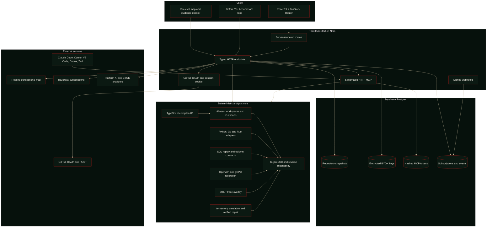
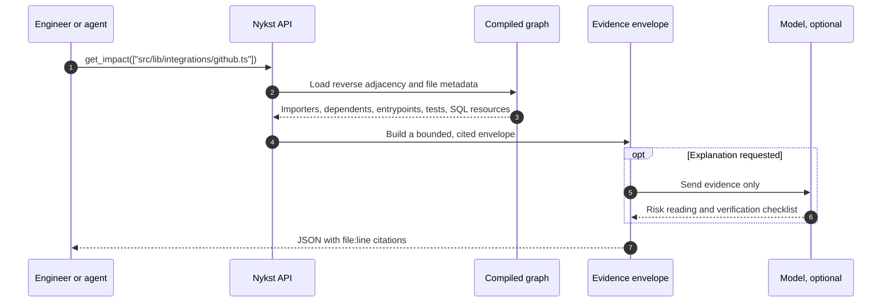

<a id="top"></a>

<p align="center">
  
</p>

<div align="center">

# Nykst

**Know what your next change will touch.**

Nykst reads a real repository and shows the files, services and database tables a change will reach, with a file and line behind every claim. Start with the consequence, then decide whether to make the edit.

Built with a TypeScript compiler core, static polyglot adapters, SQL lineage, OpenAPI and gRPC federation, OpenTelemetry overlays, and a read-only MCP server for the tools you already use.

<br/>

[](https://nykst.unifies.codes)
[](https://nykst.unifies.codes/docs)
[](#quick-start)
[](https://github.com/flawsom/Nykst)

<br/>

[](#roadmap)
[](LICENSE)
[](https://github.com/flawsom/Nykst/actions/workflows/ci.yml)
[](https://github.com/flawsom/Nykst/stargazers)
[](https://github.com/flawsom/Nykst/forks)
[](https://github.com/flawsom/Nykst/releases)
[](https://github.com/flawsom/Nykst/issues)
[](https://github.com/flawsom/Nykst/pulls)
[](https://github.com/flawsom/Nykst/commits/main)
[](https://github.com/flawsom/Nykst/graphs/contributors)

</div>

<p align="center">
  
</p>

<div align="center">

**Explore** &nbsp; [Why Nykst](#why) · [Features](#features) · [Screens](#screens) · [Demo](#demo) · [Architecture](#architecture) · [Stack](#stack) · [Quick start](#quick-start) · [Structure](#structure) · [Environment](#environment) · [API](#api) · [Usage](#usage) · [Performance](#performance) · [Testing](#testing) · [Deploy](#deploy) · [Contributing](#contributing) · [Roadmap](#roadmap) · [FAQ](#faq) · [Support](#support)

</div>

<details>
<summary><b>Full table of contents</b></summary>

<br/>

1. [Why Nykst](#why)
2. [Features](#features)
3. [Screens](#screens)
4. [Demo](#demo)
5. [Architecture](#architecture)
6. [Tech stack](#stack)
7. [Quick start](#quick-start)
8. [Project structure](#structure)
9. [Environment variables](#environment)
10. [API reference](#api)
11. [Usage examples](#usage)
12. [Performance](#performance)
13. [Testing](#testing)
14. [Deployment](#deploy)
15. [Contributing](#contributing)
16. [Roadmap](#roadmap)
17. [FAQ](#faq)
18. [Acknowledgements](#acknowledgements)
19. [License](#license)
20. [Support](#support)

</details>

> [!IMPORTANT]
> **Read-only by construction.** Nykst fetches a repository with read-only access, parses it in memory, and stores structural evidence. It never writes to your repository. The eleven MCP tools are annotated `readOnlyHint: true`. Simulated changes and generated patches stay in memory and are returned as evidence, never committed.

---

<a id="why"></a>

## Why Nykst

A small change can travel through an import chain, a rendered route, a database column and a test suite before anyone notices the edge. Nykst maps that path before the edit.

| The usual loop | The Nykst loop |
| :--- | :--- |
| Search for a symbol. Open four files. Guess which callers matter. | Ask for the impact. Read the direct importers, transitive dependents, entrypoints, SQL resources and covering tests, each cited to a line. |
| Write the change. Wait for typecheck, tests or production to disagree. | Simulate the change on a cloned graph. See new cycles, unresolved imports and column drift before touching the file. |
| Re-explain the architecture in every tool and every review. | Use one evidence contract in the browser and in your coding assistant through MCP. |

### One map. Six levels.

```text
Organization  ->  System area  ->  What it does  ->  Services and data  ->  Module  ->  File
```

Every level is derived from source. Every node can be opened, searched and traced back to a real repository path. The map is a navigator, not a poster.

### The contract

- **Source is the authority.** No seeded examples, no sample data, no invented graph nodes.
- **Evidence is citable.** A file, a line and an import chain are part of the answer.
- **Read access is enough.** GitHub is used to read repositories and, optionally, to post a pull request review comment. It is never used to write code.
- **Your code is not training data.** Nykst does not use connected repositories to train models.

<div align="right"><a href="#top">Back to top</a></div>

---

<a id="features"></a>

## Features

<table>
<tr>
<td width="33%" valign="top">
<h3>🗺️ One map, six levels</h3>
<p><sub>Move from organization to file without losing context. The breadcrumb, tree, graph and browser history stay together.</sub></p>
</td>
<td width="33%" valign="top">
<h3>🎯 Blast radius before you edit</h3>
<p><sub>Reverse reachability over the import graph. Direct and transitive dependents, entrypoints, covering tests and SQL resources, all with file and line citations.</sub></p>
</td>
<td width="33%" valign="top">
<h3>🧪 Simulate in memory</h3>
<p><sub>Overlay a write or deletion on a cloned graph. New cycles, unresolved imports, removed exports and column drift appear before any file changes.</sub></p>
</td>
</tr>
<tr>
<td valign="top">
<h3>🧠 History that stays attached</h3>
<p><sub>ADRs, Mermaid diagrams, migrations and image references become checksummed memory records with citations, searchable from the browser and MCP.</sub></p>
</td>
<td valign="top">
<h3>🔌 Eleven read-only MCP tools</h3>
<p><sub>Connect Claude Code, Cursor, VS Code, Codex, Windsurf, Gemini CLI, Cline, Zed or any Streamable HTTP MCP client with one revocable token.</sub></p>
</td>
<td valign="top">
<h3>🛡️ SQL and contract lineage</h3>
<p><sub>Replay migrations in order, match literal columns to call sites, and federate OpenAPI operations and gRPC methods across repositories.</sub></p>
</td>
</tr>
<tr>
<td valign="top">
<h3>📡 Trace the runtime</h3>
<p><sub>Overlay OTLP spans on the static graph. Observed edges are marked separately from static imports, and unmatched spans are counted, not guessed.</sub></p>
</td>
<td valign="top">
<h3>🔁 Incremental by default</h3>
<p><sub>Push webhooks and a local file watcher patch only changed files. Tests assert a 500 file patch in under 15 ms.</sub></p>
</td>
<td valign="top">
<h3>🧭 Built for the editor you use</h3>
<p><sub>Click a `file:line` row to inspect the source, open the exact GitHub line, or jump into VS Code or Cursor. No proprietary editor fork.</sub></p>
</td>
</tr>
</table>

<p align="center">
  
</p>

<a id="screens"></a>

## Screens

Real captures from the current working tree, taken on 31 October 2026. No concept art, no invented dashboards.

### Landing: the first map arrives with the page

<p align="center">
  <a href="https://nykst.unifies.codes">
    
  </a>
</p>

<p align="center"><sub><b>Landing</b> · the last compiled snapshot appears immediately, then the live analysis replaces it when the server answers.</sub></p>

<table>
<tr>
<td width="50%" valign="top">
<h3>System map</h3>
<sub>Radial navigation, list view, dossier, blast radius and click-to-code evidence in one workspace.</sub><br/><br/>
<a href="https://nykst.unifies.codes/graph"></a>
</td>
<td width="50%" valign="top">
<h3>History and intelligence</h3>
<sub>Dependency topology, change intelligence, risk and grounded questions over the same source graph.</sub><br/><br/>
<a href="https://nykst.unifies.codes/intelligence"></a>
</td>
</tr>
</table>

<table>
<tr>
<td width="50%" valign="top">
<h3>MCP access</h3>
<sub>One revocable `nyk_` token and ready configurations for the coding assistants you already use.</sub><br/><br/>
<a href="https://nykst.unifies.codes/mcp"></a>
</td>
<td width="50%" valign="top">
<h3>Plans</h3>
<sub>Monthly and annual terms, GST treatment, refund windows and the live checkout state from the public plan registry.</sub><br/><br/>
<a href="https://nykst.unifies.codes/subscribe"></a>
</td>
</tr>
</table>

### Mobile

<table>
<tr>
<td width="33%" align="center" valign="top">
<a href="https://nykst.unifies.codes"></a><br/>
<sub><b>Landing</b></sub>
</td>
<td width="33%" align="center" valign="top">
<a href="https://nykst.unifies.codes/graph"></a><br/>
<sub><b>System map</b></sub>
</td>
<td width="33%" align="center" valign="top">
<a href="https://nykst.unifies.codes/mcp"></a><br/>
<sub><b>MCP</b></sub>
</td>
</tr>
</table>

> [!NOTE]
> Nykst does not have a separate password screen. Sign-in is delegated to GitHub OAuth, and account controls live in the product where they are needed. Authentication is not a themed form pretending to be a local account system.

<div align="right"><a href="#top">Back to top</a></div>

---

<a id="demo"></a>

## Demo

The product is the demo. Open the canonical deployment and explore this repository live.

<div align="center">

[](https://nykst.unifies.codes)
[](https://nykst.unifies.codes/docs)

</div>

| Surface | What you can do | Open |
| :--- | :--- | :--- |
| **Landing** | See the current map, open a system area, read the evidence | [`/`](https://nykst.unifies.codes/) |
| **System map** | Walk six levels, open a dossier, inspect a file and line | [`/graph`](https://nykst.unifies.codes/graph) |
| **History** | Read change intelligence, risk and cited repository memory | [`/intelligence`](https://nykst.unifies.codes/intelligence) |
| **MCP** | Mint a token and copy a client configuration | [`/mcp`](https://nykst.unifies.codes/mcp) |
| **Health** | Read the live database, billing and mail readiness booleans | [`/api/health`](https://nykst.unifies.codes/api/health) |

<details>
<summary><b>Recorded walkthrough</b></summary>

<br/>

A recorded walkthrough is not checked into this repository. The live product is the current demo, and the screenshots above are real captures rather than a staged video. When a recording is published, it belongs here as a lightweight GIF or a linked 16:9 video, not as a blocking embed.

A GIF can be stored at `docs/assets/demo.gif` and embedded with:

```markdown

```

For an MP4, upload it to a GitHub issue or release and link the attachment. For YouTube, link the video from a 16:9 thumbnail so the README stays fast. The project does not claim a video that does not exist.

</details>

<div align="right"><a href="#top">Back to top</a></div>

---

<a id="architecture"></a>

## Architecture

One evidence contract serves the browser, the API and the MCP layer.



### What is actually deterministic

| Concern | How it is computed | Where it lives |
| :--- | :--- | :--- |
| Imports and exported signatures | TypeScript compiler API, merged overload envelopes, lexical scopes and namespace calls | `src/lib/analysis/parse.server.ts` |
| Cycles | Iterative Tarjan SCC, with runtime cycles separated from `import type` | `src/lib/analysis/engine.server.ts` |
| SQL lineage | DDL replay in migration order, literal column matching and drift findings | `src/lib/analysis/sql.ts` |
| Change simulation | Overlay on a cloned graph, no write to disk | `src/lib/analysis/simulate.ts` |
| Repair | Four strategies, returned only after the in-memory breakage score falls | `src/lib/analysis/fix.ts` |
| Contracts | OpenAPI and gRPC methods matched to literal consumer routes | `src/lib/analysis/federation.ts` |
| Runtime evidence | OTLP spans matched to exact or unique paths, never guessed | `src/lib/analysis/telemetry.ts` |

<details>
<summary><b>One question, end to end</b></summary>

<br/>



</details>

### Transactional mail

Two repository-controlled messages leave Nykst. Both are transactional, and both use the same table-based shell in `src/lib/email/template.ts`.

| Message | Trigger | Recipient | What it contains |
| :--- | :--- | :--- | :--- |
| Contact receipt | A contact message is stored | The address that submitted the form | Reference, topic, received time in IST, full message, reply promise and a reply-to action |
| GitHub sign-in notice | A GitHub OAuth callback succeeds | The verified GitHub email, primary first | GitHub login, IST time, coarse browser and operating system, OAuth method and a security link |

The template uses a 600 px table layout, inline styles, a hidden preheader, escaped dynamic values, constant URLs and a complete plain-text sibling. There is no tracking pixel, remote image, web font, script or marketing list. Owner notification is stored first; mail failure does not remove the row or block a GitHub sign-in.

<div align="right"><a href="#top">Back to top</a></div>

---

<a id="stack"></a>

## Tech stack

<table>
<tr><td width="18%"><b>Frontend</b></td><td>


</td></tr>
<tr><td><b>Backend</b></td><td>


</td></tr>
<tr><td><b>Data</b></td><td>


</td></tr>
<tr><td><b>Cloud</b></td><td>


</td></tr>
<tr><td><b>DevOps</b></td><td>


</td></tr>
<tr><td><b>AI and agents</b></td><td>


</td></tr>
<tr><td><b>APIs</b></td><td>


</td></tr>
<tr><td><b>Testing</b></td><td>


</td></tr>
<tr><td><b>Tools</b></td><td>


</td></tr>
</table>

<div align="right"><a href="#top">Back to top</a></div>

---

<a id="quick-start"></a>

## Quick start

### Prerequisites

| Tool | Version | Why |
| :--- | :--- | :--- |
| [Bun](https://bun.sh) | `>= 1.2` | Install, scripts and `bun:test` |
| Node.js | `>= 20` | Nitro runtime and tooling |
| Supabase project | Free tier is enough | Postgres, RLS and persistence |
| GitHub OAuth App | Optional for the example map | Repository access |
| Resend | Optional for local work | Transactional mail |

### Install and run

```bash
git clone https://github.com/flawsom/Nykst.git
cd Nykst
bun install
bun run dev
```

Open `http://localhost:8080`. The landing page and the local analyzer work without database credentials. Persistence, chat, MCP tokens, billing and mail need the environment below.

### Verify the checkout

```bash
bunx tsc -b --noEmit
bun test ./tests
bun run check:claims
bun run lint
bun run build
```

### Connect an agent

```bash
# Writes .mcp.json, .cursor/mcp.json, .vscode/mcp.json,
# .windsurf/mcp.json, .nykst/mcp.json and .nykst/codex.toml
npx nykst init --token "$NYKST_TOKEN"
```

### Database

Apply `supabase/schema.sql` in the Supabase SQL editor. It is idempotent. Or apply the chronological migrations:

```bash
for file in supabase/migrations/*.sql; do
  psql "$DATABASE_URL" -f "$file"
done
```

Then check the readiness response:

```bash
curl -s http://localhost:8080/api/health | jq
```

### Environment

Create `.env.local` at the repository root and never commit it. The complete variable table is in [Environment variables](#environment). A minimum full-stack setup:

```bash
SUPABASE_URL=https://<ref>.supabase.co
SUPABASE_PUBLISHABLE_KEY=sb_publishable_...
SUPABASE_SERVICE_ROLE_KEY=eyJ...
VITE_SUPABASE_URL=https://<ref>.supabase.co
VITE_SUPABASE_PUBLISHABLE_KEY=sb_publishable_...

GITHUB_CLIENT_ID=Ov23li...
GITHUB_CLIENT_SECRET=...
NYKST_BYOK_SECRET=<32+ random characters>

RESEND_API_KEY=re_...
CONTACT_MAIL_FROM=Nykst <contact@yourdomain>

RAZORPAY_KEY_ID=rzp_test_...
RAZORPAY_KEY_SECRET=...
RAZORPAY_WEBHOOK_SECRET=...
RAZORPAY_PLAN_ID_MONTHLY=plan_...
RAZORPAY_PLAN_ID_ANNUAL=plan_...
```

### Docker

The repository does not ship a Dockerfile, but the Nitro output is a standard Node server. Add this file if you want a container:

```dockerfile
FROM oven/bun:1.4-alpine AS build
WORKDIR /app
COPY package.json bun.lock ./
RUN bun install --frozen-lockfile
COPY . .
RUN bun run build

FROM node:22-alpine AS runtime
WORKDIR /app
ENV NODE_ENV=production
ENV PORT=8080
COPY --from=build /app/.output ./.output
EXPOSE 8080
CMD ["node", ".output/server/index.mjs"]
```

```bash
docker build -t nykst:latest .
docker run --env-file .env.local -p 8080:8080 nykst:latest
```

### Cloudflare Workers

`wrangler.jsonc` is included. The app is built with Nitro, then deployed with Wrangler:

```bash
bun run build
npx wrangler secret put SUPABASE_SERVICE_ROLE_KEY
npx wrangler secret put GITHUB_CLIENT_SECRET
npx wrangler secret put NYKST_BYOK_SECRET
npx wrangler deploy
```

### Production

The canonical deployment is Vercel at [nykst.unifies.codes](https://nykst.unifies.codes). See [Deployment](#deploy) for the provider-by-provider guide.

<div align="right"><a href="#top">Back to top</a></div>

---

<a id="structure"></a>

## Project structure

```text
Nykst/
├── src/
│   ├── components/
│   │   ├── brand/                 Nykst mark and wordmark
│   │   ├── graph/                 Map, dossier, safe loop, code inspector
│   │   ├── site/                  Landing, plans, FAQ, header, motion
│   │   └── ui/                    Radix and Tailwind primitives
│   ├── lib/
│   │   ├── analysis/              AST, graph, SQL, simulation, federation
│   │   ├── email/                 Branded transactional HTML and copy
│   │   ├── integrations/          GitHub OAuth and repository ingestion
│   │   ├── memory/                ADRs, diagrams, migrations, images
│   │   ├── connectors/            Slack and Jira
│   │   ├── mcp.server.ts          Streamable HTTP MCP implementation
│   │   └── pricing.ts             INR plans and live checkout gates
│   ├── routes/                    Pages and typed server endpoints
│   ├── integrations/supabase/     Client, server and auth middleware
│   └── styles.css                 Semantic tokens and motion rules
├── supabase/
│   ├── schema.sql                 Consolidated idempotent schema
│   └── migrations/                Chronological SQL migrations
├── tests/                         35 unit suites
├── e2e/                           Playwright journeys
├── docs/
│   ├── assets/                    README banner, divider and real screens
│   ├── mcp-contract.md            MCP transport and error contract
│   ├── mcp-tools.json             Published tool catalog
│   └── openapi.json               Published HTTP contract
├── scripts/                       Snapshot, screenshots, claims and plans
├── bin/nykst.mjs                  npx nykst init and watch
└── .github/workflows/             CI and browser workflows
```

The analysis source is intentionally separate from the application shell. The same functions that build the browser map also feed `/api/analysis/self` and the MCP server.

<div align="right"><a href="#top">Back to top</a></div>

---

<a id="environment"></a>

## Environment variables

The app reads server secrets from `process.env`. Public `VITE_` values are intentionally limited to the Supabase URL and publishable key.

### Required for the full product

| Variable | Scope | Description |
| :--- | :--- | :--- |
| `SUPABASE_URL` | Server | Supabase project URL for server queries. |
| `SUPABASE_PUBLISHABLE_KEY` | Server | RLS-scoped key used for authenticated reads. |
| `SUPABASE_SERVICE_ROLE_KEY` | Server | Server-only writes. Never expose it to the browser. |
| `VITE_SUPABASE_URL` | Client | Browser Supabase URL. |
| `VITE_SUPABASE_PUBLISHABLE_KEY` | Client | Browser publishable key, guarded by RLS. |
| `GITHUB_CLIENT_ID` | Server | GitHub OAuth app client id. |
| `GITHUB_CLIENT_SECRET` | Server | OAuth token exchange and state signing. |
| `NYKST_BYOK_SECRET` | Server | Derives the AES-256-GCM key for user AI provider keys. |
| `RESEND_API_KEY` | Server | Sends the contact receipt and GitHub sign-in notice. |
| `CONTACT_MAIL_FROM` | Server | Verified Resend sender address. |
| `RAZORPAY_KEY_ID` | Server | Razorpay key id. The prefix selects test or live mode. |
| `RAZORPAY_KEY_SECRET` | Server | Server-side subscription creation and signature verification. |
| `RAZORPAY_WEBHOOK_SECRET` | Server | Verifies the exact Razorpay webhook body. |
| `RAZORPAY_PLAN_ID_MONTHLY` | Server | Monthly plan id created by `bun run razorpay:plans`. |
| `RAZORPAY_PLAN_ID_ANNUAL` | Server | Annual plan id created by `bun run razorpay:plans`. |

### Optional, by surface

<details>
<summary><b>Integrations, webhooks, AI and billing gates</b></summary>

<br/>

| Variable | Surface | Description |
| :--- | :--- | :--- |
| `GITHUB_WEBHOOK_SECRET` | Webhooks | Verifies `X-Hub-Signature-256` on GitHub push and pull request events. |
| `GITHUB_BOT_TOKEN` | Pull requests | Fine-grained token for reading changed files and posting the blast-radius review comment. It does not write repository contents. |
| `GITHUB_REDIRECT_URI` | OAuth | Optional absolute callback override. Otherwise the host is matched automatically. |
| `GITHUB_APP_SLUG` | OAuth | Switches the connect flow from an OAuth app to a GitHub App installation. |
| `NYKST_AI_API_KEY` | Platform AI | Platform model key for the first question before a user connects BYOK. |
| `NYKST_AI_BASE_URL` | Platform AI | HTTPS OpenAI-compatible endpoint. |
| `NYKST_AI_MODEL` | Platform AI | Platform model id. |
| `GEMINI_API_KEY` | Platform AI | Optional secondary platform provider. |
| `NYKST_ADMIN_GITHUB_ID` | Admin | Numeric GitHub id allowed into `/admin/payments`. |
| `RESEND_WEBHOOK_SECRET` | Inbound mail | Verifies inbound Resend events before storage. |
| `SLACK_CLIENT_ID` / `SLACK_CLIENT_SECRET` | Slack | Enables the `/nykst` Slack command and connection flow. |
| `JIRA_CLIENT_ID` / `JIRA_CLIENT_SECRET` | Jira | Enables issue correlation and the Jira connection flow. |
| `NYKST_LIVE_PAYMENTS_APPROVED` | Billing gate | Founder sign-off for live checkout. Anything except `true` keeps live checkout closed. |
| `NYKST_GST_CONFIRMED` | Billing gate | Tax confirmation for the GST-inclusive price. Anything except `true` keeps live checkout closed. |
| `RAZORPAY_LIVE_MODE` | Billing gate | Kill switch for live keys. It cannot turn a test key into live checkout. |

</details>

> [!WARNING]
> `SUPABASE_SERVICE_ROLE_KEY`, `GITHUB_CLIENT_SECRET`, `NYKST_BYOK_SECRET`, `RESEND_API_KEY` and every Razorpay secret belong on the server. Never place them in a `VITE_` variable and never commit `.env.local`.

<div align="right"><a href="#top">Back to top</a></div>

---

<a id="api"></a>

## API reference

**Base URL** `https://nykst.unifies.codes`<br/>
**Local** `http://localhost:8080`<br/>
**Machine-readable contracts** [`docs/openapi.json`](docs/openapi.json) and [`docs/mcp-tools.json`](docs/mcp-tools.json)

### Authentication

- **Browser and app routes:** `HttpOnly; Secure; SameSite=Lax` session cookie set by the GitHub OAuth callback.
- **MCP:** `Authorization: Bearer nyk_<token>`. Tokens are stored as SHA-256 hashes and shown once.
- **Webhooks:** HMAC verification over the exact raw request body.

| Method | Path | Auth | Purpose |
| :---: | :--- | :---: | :--- |
| `GET` | `/api/health` | Public | Database, billing schema and mail readiness booleans |
| `GET` | `/api/analysis/self` | Public | Compile the current workspace; `?path=`, `?tool=`, `?query=`, `?refresh=1` |
| `GET` | `/api/integrations/github/start` | Public | Start GitHub authorization with a signed state cookie |
| `GET` | `/api/integrations/github/callback` | Public | Verify state, exchange the code, send the sign-in notice, set the session |
| `POST` | `/api/integrations/github/ingest` | Session | Analyze a repository and store the structural snapshot |
| `GET` | `/api/integrations/github/latest` | Session | Newest snapshot plus ingested workspaces; `?repo=owner/name` |
| `GET` | `/api/integrations/github/file-evidence` | Session or Public | Source window, `#L` link and editor path for a real line |
| `POST` | `/api/loop` | Public or Session | Four-stage safe loop: evidence, proposal, overlay, verdict |
| `POST` | `/api/ai/chat` | Public or BYOK | Grounded question about architecture or a selected file |
| `GET` | `/api/mcp/schema` | Public | The published eleven-tool catalog |
| `POST` | `/api/mcp` | Bearer `nyk_` | Streamable HTTP MCP |
| `GET` `POST` `DELETE` | `/api/mcp-tokens` | Session | Mint, list and revoke MCP tokens |
| `POST` | `/api/contact` | Public | Validate, rate limit, store and notify; returns a `NYKST-XXXXXXXX` reference |
| `POST` | `/api/webhooks/github` | HMAC | Incremental push patches, production signals and PR blast-radius comments |
| `POST` | `/api/webhooks/razorpay` | HMAC | Verify and apply subscription lifecycle events |
| `POST` | `/api/webhooks/resend` | Svix | Verify and store inbound replies |
| `GET` | `/api/plans` | Public | Current plan terms and checkout state |
| `GET` `POST` | `/api/subscription` | Session | Subscription state and settlement submission |
| `POST` | `/api/billing/subscription` | Session | Start a Razorpay subscription |
| `POST` | `/api/billing/verify` | Session | Verify the payment signature and start the trial |

### Example: ask the public map for a blast radius

```bash
curl -s "https://nykst.unifies.codes/api/analysis/self?path=src/lib/integrations/github.ts&tool=get_impact" \
  | jq '{
      repository,
      stats,
      target: .selectedTarget.path,
      level: .selectedTarget.briefing.impact.level,
      directImporters: (.selectedTarget.briefing.impact.direct_importers | length)
    }'
```

```json
{
  "repository": "flawsom/nykst",
  "stats": {
    "sourceFiles": 278,
    "internalEdges": 630,
    "unresolvedImports": 0,
    "loc": 51939
  },
  "target": "src/lib/integrations/github.ts",
  "level": "High"
}
```

The shape is stable. Counts depend on the deployed tree. The committed snapshot in `src/lib/analysis/self-snapshot.json` is the reproducible basis for the numbers in [Performance](#performance).

### Example: call an MCP tool

```bash
curl -s -X POST "https://nykst.unifies.codes/api/mcp" \
  -H "Authorization: Bearer $NYKST_TOKEN" \
  -H "Content-Type: application/json" \
  -d '{
    "jsonrpc": "2.0",
    "id": 1,
    "method": "tools/call",
    "params": {
      "name": "get_impact",
      "arguments": { "paths": ["src/lib/analysis/engine.server.ts"] }
    }
  }' | jq
```

### The MCP tools

Eleven MCP tools are exposed at `/api/mcp`: `list_repositories`, `get_architecture`, `get_impact`, `find_usages`, `search_files`, `search_memory`, `get_federation`, `simulate_change`, `generate_fix_patch`, `run_safe_code_loop`, `get_trace_overlay`. All 11 read-only tools carry a complete input schema.

The committed schema is checked against the executable catalog by `tests/mcp-contract.test.ts`. The transport contract is in [`docs/mcp-contract.md`](docs/mcp-contract.md).

<div align="right"><a href="#top">Back to top</a></div>

---

<a id="usage"></a>

## Usage examples

### Connect Claude Code

```bash
claude mcp add --transport http --scope user nykst \
  https://nykst.unifies.codes/api/mcp \
  --header "Authorization: Bearer $NYKST_TOKEN"
```

### Connect Cursor or VS Code

```json
{
  "mcpServers": {
    "nykst": {
      "url": "https://nykst.unifies.codes/api/mcp",
      "headers": { "Authorization": "Bearer ${env:NYKST_TOKEN}" }
    }
  }
}
```

### Simulate a change without writing it

```bash
curl -s -X POST "https://nykst.unifies.codes/api/mcp" \
  -H "Authorization: Bearer $NYKST_TOKEN" \
  -H "Content-Type: application/json" \
  -d '{
    "jsonrpc": "2.0",
    "id": 2,
    "method": "tools/call",
    "params": {
      "name": "simulate_change",
      "arguments": {
        "changes": [
          { "path": "src/lib/analysis/patch.server.ts", "content": "export const patched = true;\n" },
          { "path": "src/lib/analysis/telemetry.ts", "content": null }
        ]
      }
    }
  }' | jq '.result.structuredContent | { overlay, after, new_cycles, new_unresolved_imports, column_drift }'
```

Nothing is written. The result is computed on a cloned graph, so the repository, the database and the stored analysis stay unchanged.

### Run the analyzer locally

```bash
bun scripts/analyze-local.ts . --json /tmp/nykst-map.json
jq '{stats, cycles: (.cycles | length)}' /tmp/nykst-map.json
```

### Review a pull request diff

```bash
bun scripts/analyze-local.ts . \
  --changed src/lib/analysis/engine.server.ts,src/routes/api.webhooks.github.ts
```

### Teach an agent the order of operations

```markdown
## Before editing

1. Call simulate_change with the files you plan to write or delete.
2. Call get_impact and read every importer and entrypoint.
3. If the change touches a table, service or environment variable, call find_usages.
4. If an import or call contract breaks, call generate_fix_patch. Apply only a verified diff.
5. Run the covering tests returned by get_impact.
6. Cite file:line. If evidence is missing, say so.
```

<div align="right"><a href="#top">Back to top</a></div>

---

<a id="performance"></a>

## Performance

### Measured and asserted

| Metric | Value | How it is obtained |
| :--- | :--- | :--- |
| Analyzed source | **278 files, 51,939 LOC** | `bun run check:claims` |
| Internal import edges | **630, zero unresolved** | same |
| Cycles | **0** | `jq '.cycles \| length' src/lib/analysis/self-snapshot.json` |
| SQL and data resources | **15** | `jq '.resources \| length'` |
| External services | **11** | `jq '.services \| length'` |
| Cold AST compile | **1,123 ms for 278 files** in the committed snapshot, 31 Oct 2026 | `jq .stats.durationMs src/lib/analysis/self-snapshot.json` |
| Incremental patch | **under 15 ms for 500 files**, asserted | `bun test tests/incremental-patch.test.ts` |
| MCP tools | **11 read-only tools**, asserted | `bun test tests/mcp-contract.test.ts` |

One cold compile is not a benchmark. It is a reproducible measurement from a named snapshot. Network, region and database latency are separate.

### Lighthouse

No Lighthouse score is asserted in this repository. Scores depend on the deploy region, network and Supabase latency. Run the audit against your own deployment:

```bash
npx lighthouse https://nykst.unifies.codes --preset=desktop --view
npx lighthouse https://nykst.unifies.codes --preset=mobile --view
```

| Category | Target |
| :--- | :--- |
| Performance | 90 or higher on desktop |
| Accessibility | 100 |
| Best practices | 100 |
| SEO | 100 |

<div align="right"><a href="#top">Back to top</a></div>

---

<a id="testing"></a>

## Testing

```bash
bun test ./tests              # unit suite
bun test --coverage ./tests   # coverage report
bunx tsc -b --noEmit          # strict project typecheck
bun run lint                  # ESLint
bun run format                # Prettier
bunx playwright test          # browser journeys on a built server
bun run screens               # refresh the README captures
```

Latest local run on 31 October 2026: **267 pass, 0 fail, 2,461 assertions across 35 files, 1.80 s**.

| Suite | What it proves |
| :--- | :--- |
| `analysis-contracts` | Signatures, SQL replay, column drift, in-memory deletion and verified patches |
| `compiler-resolution` | Overloads, namespace calls, barrel re-exports, lexical shadowing and auto-heal |
| `graph-layout` | Radial orbit geometry, viewport bounds and Bezier edges |
| `incremental-patch` | Patched graphs match cold compiles and 500 files patch under 15 ms |
| `federation` | OpenAPI, gRPC and cross-repository consumer edges |
| `telemetry` | OTLP decoding, exact and suffix matching, p50 and p95 |
| `email` | Receipt and sign-in copy, escaping, recipients, idempotency and verified addresses |
| `pricing` | INR amounts, paise, trial terms, refund windows and checkout gates |
| `privacy` | DPDP purposes, data map, rights and breach clocks |
| `mcp-contract` | The committed JSON schema matches all eleven executable tools |

GitHub Actions runs the typecheck, unit suite and claims check in [`ci.yml`](.github/workflows/ci.yml). The browser journeys run separately in [`e2e.yml`](.github/workflows/e2e.yml) against a built Nitro server. Browser results are reported by the workflow, not inferred from a green unit run.

<div align="right"><a href="#top">Back to top</a></div>

---

<a id="deploy"></a>

## Deployment

| Surface | URL | Notes |
| :--- | :--- | :--- |
| Canonical production | [nykst.unifies.codes](https://nykst.unifies.codes) | Vercel custom domain |
| Vercel alias | [nykst.vercel.app](https://nykst.vercel.app) | `307` redirect to the canonical domain |
| Source | [github.com/flawsom/Nykst](https://github.com/flawsom/Nykst) | `main` is the deploy branch |

OAuth callbacks are host-matched, so the canonical domain, the Vercel alias, preview subdomains and `localhost:8080` all work without separate callback secrets.

### Vercel, primary

```bash
bunx vercel link
bunx vercel env add SUPABASE_SERVICE_ROLE_KEY production
bunx vercel env add GITHUB_CLIENT_SECRET production
bunx vercel env add NYKST_BYOK_SECRET production
bunx vercel env add RESEND_API_KEY production
bunx vercel env add CONTACT_MAIL_FROM production
bunx vercel env add RAZORPAY_KEY_SECRET production
bunx vercel env add RAZORPAY_WEBHOOK_SECRET production
bunx vercel --prod
```

Production deploys from `main`. A failed build does not replace the last healthy deployment. No build step rewrites repository data, so a rollback needs no database step.

<details>
<summary><b>Cloudflare Workers</b></summary>

<br/>

`wrangler.jsonc` is included for a Workers deployment. Add server secrets with `wrangler secret put`, run `bun run build`, then `npx wrangler deploy`.

</details>

<details>
<summary><b>Netlify</b></summary>

<br/>

- Build command: `bun run build`
- Publish directory: `.output/public`
- Functions directory: `.output/server`
- Add the server variables from [Environment variables](#environment).

</details>

<details>
<summary><b>Railway</b></summary>

<br/>

1. Create a project from `flawsom/Nykst`.
2. Build command: `bun install && bun run build`.
3. Start command: `node .output/server/index.mjs`.
4. Add the server variables and a Supabase project.

</details>

<details>
<summary><b>Docker</b></summary>

<br/>

Use the multi-stage Dockerfile in [Quick start](#quick-start). The runtime image only needs `.output` and the server environment.

</details>

<details>
<summary><b>AWS App Runner or ECS Fargate</b></summary>

<br/>

1. Build the image and push it to ECR.
2. Run it on port `8080`.
3. Load secrets from AWS Secrets Manager.
4. Point a custom domain at the service and register its callback URL on the GitHub OAuth app.

</details>

<details>
<summary><b>DigitalOcean App Platform</b></summary>

<br/>

1. Connect the GitHub repository.
2. Build command: `bun run build`.
3. Run command: `node .output/server/index.mjs`.
4. Use HTTP port `8080` and mark every secret as encrypted.

</details>

### GitHub webhook and pull request bot

1. Add `GITHUB_WEBHOOK_SECRET` and, if you want review comments, `GITHUB_BOT_TOKEN`.
2. Create a repository webhook at `https://nykst.unifies.codes/api/webhooks/github`.
3. Use `application/json`, the same secret, SSL verification, and the **Pushes** and **Pull requests** events.
4. Ingest the repository at least once. Without a snapshot the webhook returns a clear `skipped` result instead of guessing.
5. Open or synchronize a pull request. The stable marker `<!-- nykst:blast-radius -->` keeps one comment per pull request.

The optional token is fine-grained and read-only for repository metadata and pull requests. It is used only to read changed files and create or update the review comment.

<div align="right"><a href="#top">Back to top</a></div>

---

<a id="contributing"></a>

## Contributing

Contributions that sharpen the analyzer, widen language support, improve the map or strengthen the evidence are welcome.

**Branches:** `feat/<scope>`, `fix/<scope>`, `perf/<scope>`, `docs/<scope>`, `test/<scope>`

**Commits:** Conventional Commits. Example: `feat(analysis): resolve workspace package exports`.

**Authorship:** Commits must belong to the human who wrote them. Do not add bot identities, AI co-author trailers, or automated contributor identities. This includes Freebuff, Codebuff and any other automation. Tools can assist the work; the contributor graph should represent people.

**Pull request process**

1. Branch from `main` and keep the change scoped.
2. Add a test in `tests/` for analysis, connector, mail or pricing behavior.
3. Run `bunx tsc -b --noEmit`, `bun test ./tests`, `bun run check:claims` and `bun run lint`.
4. Describe the evidence: which files move, what depends on them, and which tests cover the chain. If you used Nykst itself, include the `get_impact` summary.
5. Do not commit `.env` files, generated credentials, provider tokens or private repository content.

<div align="right"><a href="#top">Back to top</a></div>

---

<a id="roadmap"></a>

## Roadmap

- [x] Deterministic TypeScript AST compiler with aliases and workspace resolution
- [x] Tarjan SCC cycle detection and reverse reachability
- [x] SQL migration replay, column drift and Prisma linking
- [x] Six-level system map with an accessible list view
- [x] Before You Act consequence envelope
- [x] Read-only Streamable HTTP MCP, now eleven tools
- [x] In-memory `simulate_change` and verified `generate_fix_patch`
- [x] Python, Go and Rust import adapters
- [x] OpenAPI and gRPC federation across repositories
- [x] OpenTelemetry trace overlay
- [x] Pull request blast-radius review comment
- [x] Encrypted BYOK provider vault
- [x] Resend transactional mail with plain-text alternatives
- [x] Razorpay monthly and annual plans with live gates
- [ ] GST invoice format confirmation
- [ ] Weekly refund window decision
- [ ] Hindi privacy notice, consent and rights controls

The open items are gated on an external decision, not hidden behind a checkmark.

<div align="right"><a href="#top">Back to top</a></div>

---

<a id="faq"></a>

## FAQ

<details>
<summary><b>Does Nykst write to my repository?</b></summary>

<br/>

No. GitHub access is read-only. Ingestion downloads repository content, parses it, and stores derived structure. The optional PR bot writes one review comment through a separately scoped token, never repository contents. `simulate_change` and `generate_fix_patch` operate on an in-memory clone.

</details>

<details>
<summary><b>Is any of the map seeded or mocked?</b></summary>

<br/>

No. The live workbench runs the analyzer over the source tree available to the server and reports the real files, imports, resources and cycles. If a source read fails, the product reports the failure instead of inventing a node.

</details>

<details>
<summary><b>How is this different from Cursor, Cody or Greptile?</b></summary>

<br/>

Those tools retrieve context, generate code or review a diff. Nykst answers a narrower, deterministic question: which files import this one, directly and transitively, which entrypoints reach it, which tests cover it, which SQL columns it uses, and what changed with it. The same evidence is available to people and to agents.

</details>

<details>
<summary><b>Which languages are supported?</b></summary>

<br/>

TypeScript and JavaScript are first class, including `.tsx`, path aliases, workspaces, overload envelopes, namespace calls and barrel re-exports. Python, Go and Rust use lightweight static adapters for imports, package boundaries, symbols, environment reads and literal endpoints. SQL migrations and Prisma models are linked as data resources. Dynamic imports, Go build tags and macro-generated Rust modules can remain unresolved; the limitation is reported.

</details>

<details>
<summary><b>How does authentication work?</b></summary>

<br/>

GitHub OAuth. The callback verifies a signed state cookie and a host-matched redirect, exchanges the code, reads a verified email when available, sends the sign-in notice, and sets an `HttpOnly` session cookie. Nykst never asks for a GitHub password. There is no local password database.

</details>

<details>
<summary><b>What happens when code changes after ingestion?</b></summary>

<br/>

A signed push webhook reads the changed paths at the pushed commit and patches the stored graph. Deleted paths are pruned and SQL bindings and SCCs are recomputed. A branch deletion or a push over 300 files asks for a full ingest instead of guessing.

</details>

<details>
<summary><b>How is billing handled?</b></summary>

<br/>

Razorpay subscriptions for monthly and annual plans, with a seven-day trial and GST-inclusive prices. The public plan registry is the source of truth. Weekly remains gated until its refund window is decided. GST invoice format and the Hindi privacy controls are also gated and are listed in the roadmap rather than presented as finished.

</details>

<details>
<summary><b>Can I self-host it?</b></summary>

<br/>

Yes. The repository is MIT licensed. You need Node or Bun, a Supabase project, a GitHub OAuth app, and the provider keys for the surfaces you enable. The Docker, Workers, Vercel and generic Node paths are documented above.

</details>

<div align="right"><a href="#top">Back to top</a></div>

---

<a id="acknowledgements"></a>

## Acknowledgements

- The **TypeScript team**, for the compiler API that makes a precise graph possible.
- **TanStack**, for Start, Router and the application model.
- **Supabase**, for Postgres, row-level security and a clean server boundary.
- **Model Context Protocol**, for a standard way to hand architectural evidence to agents.
- **Radix UI**, **Tailwind CSS**, **Lucide** and **Resend**, for the primitives and delivery layer behind the experience.
- Everyone who filed a reproducible issue with a commit hash and a clear failure.

<div align="right"><a href="#top">Back to top</a></div>

---

<a id="license"></a>

## License

Released under the [MIT License](LICENSE). Copyright (c) 2026 Nykst.

<div align="right"><a href="#top">Back to top</a></div>

---

<a id="support"></a>

## Support

If Nykst saves you from a bad change, a star helps another engineer find it.

<div align="center">

[](https://github.com/flawsom/Nykst/stargazers)
[](https://github.com/sponsors/flawsom)
[](https://www.buymeacoffee.com/nykstsoftint)
[](mailto:sibaprasadpanda56@gmail.com)

</div>

<p align="center">
  <sub>Built by <a href="https://github.com/flawsom">@flawsom</a> · <a href="https://nykst.unifies.codes">nykst.unifies.codes</a> · <a href="#top">Back to top</a></sub>
</p>
